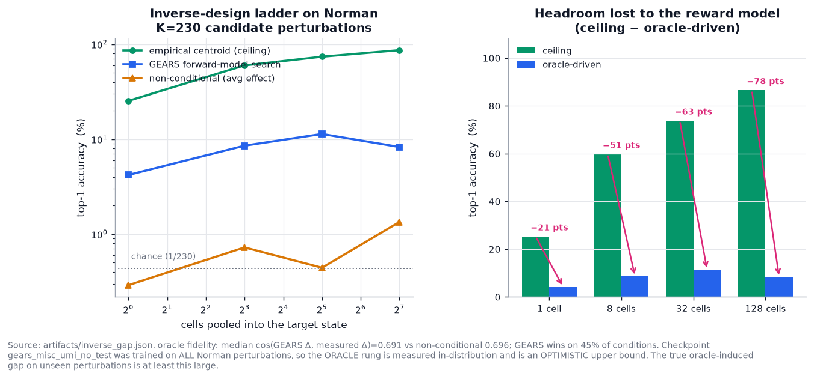
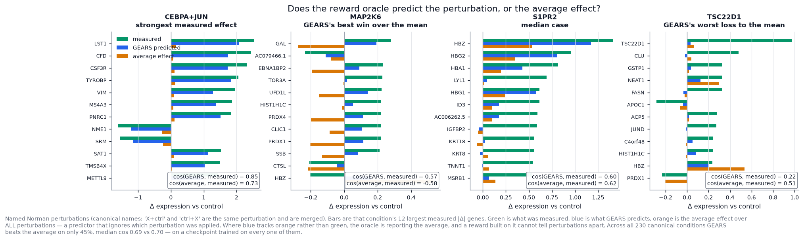
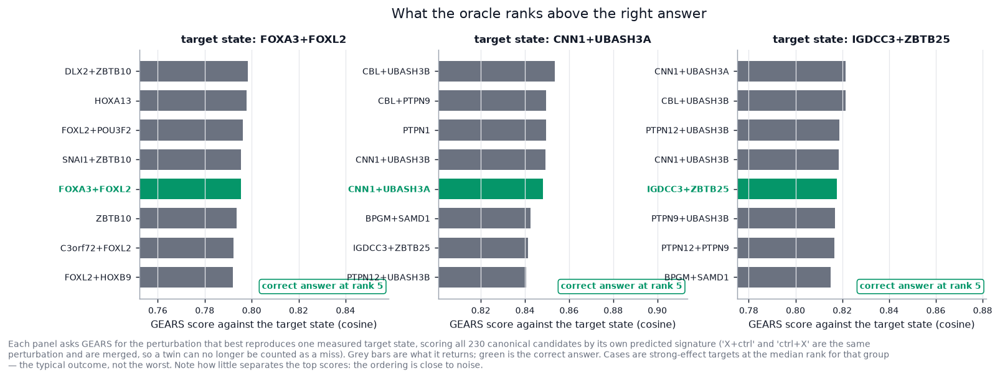
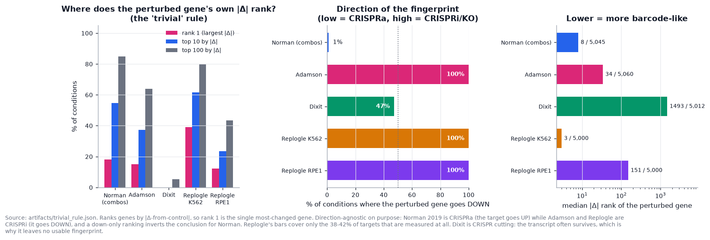
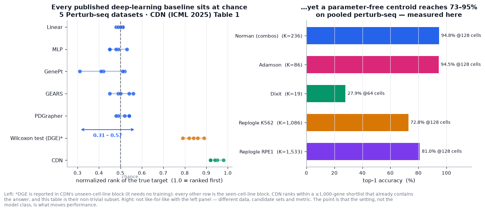

# Performance gaps in genetic inverse design

**2026-11-13.** Findings from downloading the baselines and profiling the data. Ordered by
how much performance is on the table, largest first.

Our numbers come from `/zfsauton/scratch/yixiz/10703_pj/artifacts/` and redraw with
`./submit.sh figures`. Published numbers are sourced in place. Figures referenced here
are in [figures/](figures/) and also on scratch.

---

## Summary

**Read gap 0 first — it is the one that says where to aim.** Of the three ways a candidate
perturbation can be absent from the atlas, only one is a real gap: an **unseen gene**.
Unseen *pairs* are closed completely by adding two single-gene signatures (71.6% vs a 71.1%
ceiling), and unseen *contexts* are half irreducible — the same gene genuinely acts
differently in another cell line. On the unseen-gene axis every cheap predictor, the
published linear baseline included, sits at **0.8–1.9% top-1 against a 32.5–88.9%
ceiling**. The gaps below are all measured on perturbations the atlas has already seen,
where the task is a lookup; gap 0 is the one with somewhere to go.

The reward oracle, not the generator, is what limits this project. On Norman, a
parameter-free nearest-centroid match recovers the correct perturbation **86.6%** of the
time from a 128-cell target, while ranking the same 230 candidates by GEARS-predicted
signatures recovers **8.3%** — a **78-point gap**, measured with the official checkpoint
on data it was trained on.

GEARS also fails to beat a predictor that ignores which perturbation was applied: median
cosine to the measured effect is **0.691** for GEARS against **0.696** for the average
effect, and GEARS wins on **44.8%** of conditions. RL post-training improves the
generator; it cannot recover headroom the reward signal cannot see.

Two further findings change how results should be framed. High retrieval accuracy on
perturb-seq is largely *barcode-reading* — CRISPRi lowers the target's own transcript and
CRISPRa raises it, so the answer is stamped into the readout — and that will not transfer
to designing for a phenotype. And across five Perturb-seq datasets, **every published
deep-learning method sits at or below chance** on this task, while a Wilcoxon rank-sum
test reaches 0.79–0.89.

---

## Gap 0 — Only one of the three ways to be "unseen" is actually a gap

**Added 2026-11-13, after the gaps below.** Everything below measures the task on
perturbations that have *already been measured*. For those, inverse design is a lookup:
the nearest measured centroid names the perturbation and nothing needs to be learned.
Headroom can only exist where the atlas has **no entry** for a candidate, and there are
exactly three ways that happens. They turn out to be worth entirely different amounts.

One task, held fixed across all three: a target state (pseudo-bulk of ≤32 **held-out**
cells, against an independent half of the controls) is matched against **all K**
candidates. Every learned predictor is out-of-fold over 5 folds of candidates, so no
candidate is ever scored by a model fitted on it. All numbers below are in the **masked**
gene space — every gene that is any candidate's target removed — because a design target
is a phenotype and carries no knocked-down-gene fingerprint (gap 2). `summary.json` also
carries the unmasked numbers.

| Axis | Setting | K | Ceiling | Best cheap predictor | Recovered |
|---|---|---:|---:|---|---:|
| **unseen gene** | **Norman** | **105** | **88.9%** | co-response kNN **1.9%** | **1%** |
| **unseen gene** | **Adamson** | **86** | **72.5%** | GO kNN **1.2%** | **9%** |
| **unseen gene** | **Replogle RPE1** | **1,543** | **37.7%** | GO kNN **0.8%** | **11%** |
| **unseen gene** | **Replogle K562** | **1,092** | **32.5%** | GO kNN **0.8%** | **14%** |
| unseen pair | Norman combos | 128 | 71.1% | additive, fitted **71.6%** | **100%** |
| unseen context | Adamson → K562 | 41 | 49.6% | re-centred **41.5%** | 90% |
| unseen context | K562 → Adamson | 41 | 87.0% | re-centred **50.4%** | 64% |
| unseen context | RPE1 → K562 | 848 | 36.2% | other line as-is **16.7%** | 54% |
| unseen context | K562 → RPE1 | 848 | 36.3% | re-centred **11.6%** | 39% |
| unseen context | Adamson → RPE1 | 45 | 64.4% | re-centred **20.7%** | 36% |

"Recovered" is the fraction of (ceiling − chance) the cheap predictor closes, by mean
reciprocal rank. Scoring is tie-aware — a predictor that gives several candidates the same
score gets the expected rank under random tie-breaking — so a constant predictor scores
exactly chance rather than being flattered by argmax order.

**Unseen pair is not a gap. Adding two single-gene signatures *is* the answer.** A
two-parameter fit on the training combos reaches **71.6%** against a **71.1%** ceiling —
it recovers 100% of the headroom, and 77% of combos sit within 0.9 of the noise ceiling of
pure additivity. The official GEARS checkpoint, which was **trained on these very
combinations**, gets **16.1%**: four times worse than arithmetic on data it has seen.
Norman's combinations are the headline dataset for this whole literature, and the
non-additive residual there is too small to build a method on.

**Unseen context is a weak gap, and partly not learnable.**

Between the two large Replogle lines, re-centring the other line's signature recovers 39%
of the headroom with **ten** paired measurements, and the curve is flat from there to 678
— more paired data does not help. A learned ridge map from one line to the other is
*worse* than that re-centring at every training size. The reason is in the right panel: the
cross-context cosine for one perturbation, divided by the value two noisy measurements of
an *identical* effect would reach (Spearman-Brown corrected split-half reliability), has
median **0.42** between K562 and RPE1 and **0.17** between Adamson and RPE1. Only 1% of
shared perturbations reach 0.8. The same gene genuinely does something different in
another cell line, so a large part of this gap is not a modelling failure and cannot be
closed by any method. Note also the ceiling is itself low here (36%) — K562 and RPE1
signatures are intrinsically harder to tell apart than Norman's.

**Unseen gene is the gap.** It is the only axis where the ceiling is high, the cheap
predictors are at the floor, and the shortfall is not explained by noise. GO-similarity
kNN, co-response kNN, the published linear baseline and the mean effect all sit at
**0.8–1.9% top-1 against a 32.5–88.9% ceiling**, recovering **1–14%**. On Norman the
ceiling is 88.9% and everything cheap gets 1.9%. The predictors are not failing at
fidelity — GO kNN reaches 0.46 cosine to the held-out effect against a 0.67 noise ceiling
on K562, i.e. ~70% of what is achievable — they are failing at *discrimination*: they
predict roughly the right general direction for every gene and cannot say which gene.

This also explains the Nature Methods result the field keeps rediscovering. The linear
baseline of [Ahlmann-Eltze, Huber & Anders (2025)](https://doi.org/10.1038/s41592-025-02772-6)
is in the table above, out-of-fold: **0.3–1.0% top-1**. Its paper's finding that deep
models fail to beat it is usually read as "the deep models are no good". The sharper
statement is that **both sit near the floor of a task whose ceiling is 30–90 points
higher**, and that this is the one place in the problem where that is true.

> **Why the ceiling is a fair ceiling.** It is computed from a *disjoint half* of each
> condition's cells against an *independent half* of the controls, so it is not fitting the
> query. The cheap predictors, by construction, never see the held-out gene at all — that
> is the point. The gap is between "this gene has been measured here" and "it has not".

**What this means for the project.** Pick the unseen-gene axis, on one of the two Replogle
datasets (K=1,092/1,543 is a real action space; Norman's 105 is not). Drop the combination
story — it is arithmetic — and treat cross-cell-line transfer as a measurement problem, not
a method one. The open question on this axis is sharp and unclaimed: *given a gene never
perturbed in this context, predict its effect specifically enough to tell it from 1,000
other genes.* Prior knowledge about the gene (GO, pathways, sequence, its own co-response
profile) is the only available input, and the measured value of all of it so far is ~1%.

Reproduce with `./submit.sh gen` (CPU, ~5 min) →
`artifacts/generalization/{results.jsonl,summary.json}`; redraw with `./submit.sh genfigs`.

---

## Is the unseen-gene gap RL-shaped?

**Added 2026-11-16.** Gap 0 says where the headroom is. This asks whether any of it is a
*decision* problem, since this is an RL project. Two candidate framings, both measured by
`jobs/26_rl_headroom.sbatch` (CPU, artifacts in `artifacts/rl_headroom/`).

### Framing A — a ranking objective. Dead.

The diagnosis in gap 0 was that predictors have fidelity (~70% of the noise ceiling in
cosine) but no discrimination. One explanation is that the gene-specific signal is present
and simply not scored, because squared error spends capacity on the component every
perturbation shares. If so, a ranking reward — non-differentiable, hence RL — would recover
it. We test the cheapest version: take the *same* predictions and only change the scoring
geometry. Centre them, then whiten in a subspace fitted on training genes. No information
enters.

| top-1 (masked) | ceiling | raw | centred | best whitened |
|---|---:|---:|---:|---:|
| Replogle K562 | 33.7% | 0.32% | 0.69% | 0.37% |
| Replogle RPE1 | 37.4% | 0.42% | 0.71% | 1.43% |

Whitening makes MRR *worse* everywhere (K562 0.066 → 0.011). RPE1's 1.43% looks like a 3×
gain until its MRR drops 0.053 → 0.040: it sharpens a few cases and scrambles the rest.

**The discrimination is not in the prediction waiting to be scored differently.** That kills
the rank-reward framing — and kills contrastive learning for the same reason, which is the
more useful half of the result, since contrastive is what a reviewer would demand instead
of RL. The limit is the input representation (GO terms), not the loss.

### Framing B — which genes to measure. Alive, and the shape of it is the interesting part.

The atlas is a choice. Someone picked the 1,092 genes in the K562 screen. So: state = genes
measured so far, action = which gene to measure next, transition = reveal its **real**
signature, reward = retrieval MRR on held-out genes, horizon = a budget. Discrete actions,
non-differentiable reward, and it simulates offline against real measurements — episodes are
matrix operations, no oracle model in the loop.

Budget spent in 4 rounds, reported on held-out genes the strategy never sees. `adapt_greedy`
picks greedily on its own legitimate reward (a disjoint *selection* gene set);
`oracle_greedy` runs the same greedy directly on the report set and **cheats**, bounding
what any adaptive policy could reach.

| Replogle K562, rep MRR | B=25 | B=50 | B=100 | B=200 |
|---|---:|---:|---:|---:|
| random | 0.091 | 0.111 | 0.163 | 0.225 |
| GO coverage (static) | 0.115 | 0.136 | 0.191 | 0.222 |
| adapt_greedy (honest) | 0.111 | 0.151 | 0.188 | 0.250 |
| **oracle_greedy (cheats)** | **0.174** | **0.227** | **0.307** | **0.405** |
| oracle / random | 1.91× | 2.05× | 1.88× | 1.80× |
| adapt_greedy / random | 1.22× | 1.36× | 1.15× | 1.11× |

RPE1 is harder: `adapt_greedy` reaches only 0.98–1.18× random and **loses to static GO
coverage at three of four budgets**, while `oracle_greedy` still reaches 2.0–2.7×.

Three facts, and the third is the project:

1. **The prize is real and large.** At K562 B=200, `oracle_greedy` reaches **top-1 0.327**
   against the **0.337** ceiling — choosing 200 of 656 genes well predicts the other genes
   almost as well as having measured them. The atlas is massively redundant.
2. **Cheap static heuristics get a little of it.** Greedy GO-term set-cover is ~1.2–1.3×
   random and beats *searching 200 random subsets*, so it is the baseline to beat, not
   random.
3. **Greedy on the true reward captures only ~1.2× of a ~2× prize, because the reward does
   not generalise across gene sets.** `adapt_greedy` optimises hard on 218–308 selection
   genes and most of its advantage evaporates on a disjoint 218–308. Part 2 shows the same
   thing non-adaptively: best-of-200 random subsets lands *below* the random median on two
   of five RPE1 budgets.

**That third fact is the RL problem.** It is not "apply RL to biology" — it is a
high-variance, overfitting-prone reward in a combinatorial acquisition MDP, which is what
variance reduction, learned baselines and policy generalisation exist for. The gap between
1.2× (greedy on a noisy reward) and ~2× (what exists) is the quantity a method would move,
with static GO coverage as the honest floor.

### Is the prize unfindable, or hidden behind a noisy reward?

That is the question that decides the project, and the two readings differ testably. If the
cheat's margin is pure overfitting, nothing a policy does will reach it. If instead the
reward is unbiased but **high-variance**, then growing the gene set the reward is computed
on must raise performance on a *fixed, disjoint* report set. Three-way disjoint splits:
`act` (437 genes a policy may measure), `rew` (the reward's genes, subsampled), `rep` (the
report set, which only the cheating bound ever sees). Budget 100, four rounds.

| Replogle K562 | own reward | **rep MRR** | vs random median |
|---|---:|---:|---:|
| random × 100 (median) | — | 0.178 | — |
| greedy, 25 reward genes | 0.721 | 0.168 | **−6%** |
| greedy, 50 | 0.512 | 0.171 | −4% |
| greedy, 100 | 0.409 | 0.168 | −6% |
| greedy, 200 | 0.310 | 0.214 | +20% (> p95) |
| greedy, 400 | 0.224 | **0.221** | **+24% (> p95, > max)** |
| cheat (selects on rep) | 0.293 | 0.293 | +65% |

RPE1 behaves the same way: −6% to −16% below the random median up to 200 reward genes, then
**+23%** at 400, clearing p95; the cheat sits at 2.13×.

Read the `own reward` column next to it. At 25 reward genes greedy drives its own objective
to **0.721** and delivers **0.168** held out — it is not underfitting, it is fitting noise,
and the result is **worse than choosing genes at random**. Optimising a high-variance reward
is actively harmful here; the harm disappears monotonically as the estimate improves.

**This is reading (b), and it is the project.** Three things follow:

1. **Reward quality, not search quality, is the binding constraint.** The same greedy search
   goes from −6% to +24% purely by estimating its reward better.
2. **The curve has not plateaued at 400 reward genes**, and greedy there captures only
   **37%** (K562) and **20%** (RPE1) of the cheat's demonstrated margin. Most of the prize
   is still unclaimed, and the lever is variance in the reward.
3. That is exactly what **learned baselines, reward averaging and policy generalisation**
   are for — core RL machinery, aimed at a failure mode measured here rather than assumed.

> **A methodological correction worth keeping.** Parts 3 and 4 originally compared against a
> *single* random draw. Part 2 had already shown random spans ±15% around its median, and
> the single draw used in part 4 (0.218) turned out to sit near the **maximum** of 100 draws
> (max 0.221, median 0.178) — so greedy looked flat when it was in fact beating p95. Any
> claim here is now against the median of 100 draws, with p95 and max reported. A single
> random baseline cannot measure an effect the same size as its own spread.

Reproduce with `./submit.sh rl` (`PJ_RL_PARTS="1 2"` selects parts; `PJ_RL_RANDOM_ONLY=1`
re-measures only the random distribution).

---

## Gap 1 — The reward oracle is the bottleneck, not the generator

Three scorers on one identical task — given a target cell state, rank 230 candidate
perturbations — so the rungs subtract.

- **Ceiling** — rank by the Δ-signature *measured* from labelled cells. Not a usable
  designer, but it bounds what any method could extract from a target state.
- **Oracle** — rank by the Δ-signature GEARS *predicts*. Every oracle-driven method is
  capped by this rung: PDGrapher's inverse map, LabCompass's MAP/Langevin/guidance, and
  any RL policy whose reward is this oracle.
- **Non-conditional** — the average perturbation effect, ignoring which perturbation.

| Cells pooled | Ceiling | GEARS oracle | Gap | Kept | Median rank |
|---:|---:|---:|---:|---:|---|
| 1 | 25.4% | 4.2% | 21.2 pts | 16.6% | 6 → 36 |
| 8 | 59.9% | 8.6% | 51.3 pts | 14.3% | 1 → 15 |
| 32 | 73.9% | 11.4% | 62.5 pts | 15.4% | 1 → 12 |
| **128** | **86.6%** | **8.3%** | **78.3 pts** | **9.6%** | **1 → 13** |

**Read the shape, not the heights** (the y-axis is log, which flatters the oracle). The
ceiling keeps climbing as cells are pooled; the oracle flattens near 10%. More data raises
what is achievable and does nothing for GEARS, because the limit is its prediction error,
not noise in the target.

On fidelity, the oracle does not beat the predictor that ignores perturbation identity:

| Quantity | Value |
|---|---:|
| median cos(GEARS Δ, measured Δ) | 0.691 |
| median cos(average effect, measured Δ) | **0.696** |
| conditions where GEARS wins | **44.8%** |
| median cos(GEARS Δ, average effect) | 0.768 |

Its predictions sit closer to the global average than to the truth.

Named cases, each panel labelled with *why* it was chosen so you can see they aren't
cherry-picked. Ask of each: does blue track green, or orange? In the **median case
`S1PR2`** the average effect scores **0.62 against GEARS's 0.60**. In `TSC22D1` the
measured activation of the target is ≈1.0 while GEARS predicts ≈0.05, missing the CRISPRa
target's own induction.

Ranking is close to noise. For target `CNN1+UBASH3A` the top score is **0.853** and the
correct answer **0.848** — five ranks inside 0.005. `CNN1+UBASH3A` is also GEARS's top
pick for an unrelated target (`IGDCC3+ZBTB25`): it funnels different queries toward the
same few combinations, which is what predicting the average looks like in practice.

---

## Gap 2 — Retrieval success is barcode-reading, not design

Where the perturbed gene's own |Δ| ranks among all measured genes. Direction-agnostic on
purpose: Norman is CRISPRa (target goes *up*), the others CRISPRi/cutting (target goes
*down*).

| Dataset | Rank 1 | Top 10 | Top 100 | Median rank | Target unmeasured | Direction |
|---|---:|---:|---:|---:|---:|---|
| norman | 18.0% | 54.8% | 84.8% | **8** / 5,045 | 0% | up (CRISPRa) |
| replogle_k562_essential | 39.2% | 61.6% | 80.0% | **3** / 5,000 | 62% | down |
| adamson | 15.1% | 37.2% | 64.0% | 34 / 5,060 | 0% | down |
| replogle_rpe1_essential | 12.3% | 23.4% | 43.5% | 151 / 5,000 | 58% | down |
| **dixit** | 0.0% | 0.0% | **5.3%** | **1,493** / 5,012 | 0% | mixed |

**Retrievability tracks fingerprint strength, and Dixit proves it by exception.** Dixit
leaves no fingerprint — it is CRISPR *cutting*, so the transcript often survives — and it
is the one dataset where retrieval fails (25.8% top-1 over just 19 candidates, median rank
never below 3).

> **The direction correction mattered.** Ranking only by most-downregulated inverted the
> conclusion for Norman, whose CRISPRa targets go *up*: it read rank 5,029 of 5,045 from
> the bottom, which is rank 8 from the top. The first version of this analysis had Norman
> as the *least* barcode-like dataset when it is the most.

One named perturbation per dataset, each the case closest to that dataset's *median* rank.
`DLX2` (Norman) is pink near the top going up; `DNTTIP2` (Replogle K562) is the single
largest down bar; `CREB1` (Dixit) has no pink bar at all — rank 1,493, buried.

**Why it matters:** a design task specifies its target by a desired *phenotype*, which
carries no knocked-down-gene fingerprint. The published identification numbers, good or
bad, do not transfer. The relevant baseline for this project is Gap 1's oracle rung, not
the ceiling.

---

## Gap 3 — The target must be a population, not a single cell

The proposal says "user-specified target cell state" without saying how many cells define
it. That unstated choice is worth more than every published model-vs-model gain combined.

| Dataset | K | 1 cell | Best pooled |
|---|---:|---:|---:|
| norman (canonical) | 236 | 37.7% | **94.8%** |
| adamson | 86 | 33.7% | **94.5%** |
| replogle_rpe1_essential | 1,533 | 11.4% | 81.0% |
| replogle_k562_essential | 1,086 | 12.9% | 72.8% |
| dixit | 19 | 11.6% | 25.8% |

Parameter-free nearest-centroid, no training. Median rank on Replogle RPE1: **90 at one
cell, 1 at 32**.

The cause is single-cell SNR (`fig3`, left panel): the ratio of mean shift to mean
per-cell residual norm has median 0.22–0.35 and sits below 1.0 for every condition in all
five datasets. Below 1 is *expected* in ~5,000 dimensions and means a single cell's
deviation is noise-dominated — not that the perturbation has no effect. Pooling recovers it.

**Two consequences.** Fix the target to a pseudo-bulk of ≥32 cells and say so. And this
baseline costs nothing to run, so it belongs in every results table: an RL method landing
under 94.8% on Norman has no result.

---

## Gap 4 — No published learned method beats a statistical test

The cross-method check, run because one paper's weak numbers could be that paper's
artifact. They are not. From [CDN (Wu et al., ICML 2025)](https://arxiv.org/abs/2410.03380)
Table 1, five Perturb-seq datasets, normalized rank where **0.5 is chance**:

| Method | Range | Kind |
|---|---:|---|
| Linear | 0.45 – 0.51 | deep-learning baseline |
| MLP | 0.45 – 0.53 | deep-learning baseline |
| GenePt | **0.31** – 0.52 | deep-learning baseline |
| GEARS | 0.45 – 0.56 | our proposed oracle |
| PDGrapher | 0.48 – 0.54 | published inverse SOTA |
| *chance* | *0.50* | — |
| **Wilcoxon + BH** | **0.79 – 0.89** | a statistical test |
| CDN | 0.92 – 0.98 | shortlisted, non-trivial subset |

GenePt (0.31) and PDGrapher (0.39 unseen cell line) fall *below* chance. The authors state
it directly: *"no other deep learning method exceeds simple statistical tests."*

CDN's own 0.92–0.98 needs its conditions attached: it ranks inside a ≤1,000-gene shortlist
that already contains the answer, reports **no top-1 accuracy anywhere on real data**, and
excludes the majority of perturbations as "trivial" (the target simply *is* the most-changed
gene). On that trivial subset CDN scores 0.99 and every deep-learning baseline is still
0.40–0.60.

PDGrapher's own extended-data figure agrees on bulk LINCS. Its genetic panels plot **nine
methods together** and the axis ceilings bound all of them: accurately predicted samples
**0–1.5%**, nDCG **0–0.12**, recall@1/@10/@100 within **0–0.14**, over ~10,716 candidate
genes. The caption concedes scGen — not PDGrapher — leads on nDCG, and that PDGrapher
recovers targets "at comparable rates". The one absolute pair given is **1.37% vs 0.28%**
on Ovary-ES2.

STATE corroborates on the forward side: on genetic data it *"matched the performance of
the perturbation mean baseline"*, and a linear model beat it on DE overlap by 20%.

---

## Gap 5 — The design space is too small for the proposed machinery

| Source | Perturbable genes |
|---|---:|
| PDGrapher evaluation (BioGRID PPI nodes) | **10,716** |
| replogle_rpe1_essential | 1,543 |
| replogle_k562_essential | 1,092 |
| **norman** | **105** (→ 152 single + 131 combo) |
| adamson | 86 |
| dixit | 19 |

Against ~20,000 protein-coding genes. Norman's 131 combinations cover **2.4%** of the
5,460 possible pairs from its 105 genes. The 7×–500× mismatch between what a model is
*scored* over and what it has *labels* for is a large part of why recall@1 is under 1%.

At this scale the problem is a contextual bandit, where a softmax policy gradient — or
simply scoring every arm through the oracle — beats post-training a flow model. **Either
commit to k-gene subsets over the full genome, where enumeration is impossible and a
generator is justified, or accept this is a bandit and use the simple method.** The middle
ground is the one place the proposed machinery has no advantage.

---

## Gap 6 — Cycle consistency cannot separate right from nearly-right

Median cosine between a perturbation's Δ-signature and that of its **nearest other**
perturbation (middle panel, read where each line crosses 50%):

| adamson | dixit | norman | replogle_rpe1 | replogle_k562 |
|---:|---:|---:|---:|---:|
| 0.91 | 0.93 | 0.85 | 0.74 | 0.58 |

For a typical perturbation some *different* perturbation produces a near-identical
signature, so reproducing the target does not prove you found the cause. `fig12` shows the
same thing from the other side: top five candidates separated by 0.005.

**PDGrapher ablates this exact mechanism and reports against it.** `PDGrapher-Super`
"achieves the highest performance in predicting correct perturbagens", while the shipped
`PDGrapher-SuperCycle` has "slightly lower performance in pinpointing targets". Adding the
cycle term *traded away* target accuracy. (Their ablation was chemical-only.)

If the term is kept: whiten or decorrelate the signature space first, or score only on each
condition's own DE-gene subset, and report cycle consistency as a **rank** against all
candidates rather than an absolute distance.

The right panel carries a separate warning: stronger perturbations move more genes, so a
sparsity reward fights biology rather than selecting for cleanliness.

---

## Gap 7 — Most of the large action spaces are invisible to the oracle

Right panel of [`fig1_action_space.png`](figures/fig1_action_space.png). Fraction of
perturbed genes that are themselves measured:

| norman | adamson | dixit | replogle_k562 | replogle_rpe1 |
|---:|---:|---:|---:|---:|
| 100% | 100% | 100% | **38%** | **42%** |

The first three read 100% only because GEARS filtered them to measured genes — and they
are the small ones. On the only two datasets with an action space above ~100 genes, the
oracle cannot report the expression of the gene you perturbed for most actions. An
on-target-knockdown or cycle-consistency reward is not merely weak there, it is
**unmeasurable**.

Note the collision with Gap 2: Replogle K562 has the strongest fingerprint of any dataset
(median rank 3 of 5,000) and simultaneously the weakest coverage (38%). The signal that
makes retrieval easy is unavailable across most of its action space.

---

## Novelty re-scoping

LabCompass's code was released **2026-10-28**, after the proposal was written. Reading it
narrows the claim. In `code/LabCompass/src/labcompass/`:

- `inverse/loss_guidance.py` → `LossGuidedFlow` steers a pretrained flow toward
  `loss_fn(x1) + c·Σ reg_fn(x1)`. That is penalties from biological restraints, already
  weighted and composable.
- `inverse/kkt.py` + `inverse/implicit_dual_opt.py` → `KKTConditions`,
  `ImpliciDualGuidedFlow` implement **inequality constraints `g_i(x1) ≤ 0`** with Lagrange
  multipliers by least squares. Hard constraints arguably fit biological restraints better
  than reward weights — "stay under k perturbed genes", "avoid this pathway" are
  constraints, not preferences, and KKT needs no weight tuning.
- `models/inverse.py` → `InverseModel(inverse_method=...)` takes `"map"`, `"langevin"` and
  **`"neural"`**. The last predicts perturbation covariates directly, so "replacing search
  with learning" already ships.

Guidance and KKT both differentiate the objective w.r.t. the generated variable. What is
genuinely left, and worth claiming precisely:

1. **Non-differentiable, black-box rewards** — a selectivity score that is a rank statistic
   over oracle output, sparsity as an L0 count, pathway avoidance as set membership, or any
   call to a non-differentiable simulator. RL needs only a scalar. *The proposal does not
   currently claim this, and it is the strongest claim available.*
2. **Discrete action spaces** — gene sets are discrete; continuous guidance needs a
   relaxation, a discrete policy does not.
3. **Reward composition at training time** rather than per-target re-tuning of weights.

That reframing fixes the headline experiment: **our RL policy vs LabCompass guidance on a
differentiable reward** (the control, should be comparable) **and on a reward that is not**
(where only RL can run).

Two related points. PDGrapher is not a drop-in baseline for this framing — its genetic task
is disease→treated across 10 cell lines with one target phenotype per line, so it cannot be
asked for an arbitrary target state. And three 2026 works occupy adjacent ground, all
uncited because they postdate the proposal: **PertMind** (arXiv 2608.16419, RL on
perturbation data via an LLM), a **NeurIPS 2026** paper on compositional perturbation
planning with a generative structural causal world model, and **U-Pert** (bioRxiv
2026.06.30.735555, inverse design for target gene programs, no public code found).

---

## Recommendations

In priority order; the first gates the rest.

1. **Measure the oracle held-out before designing any reward.** Run
   `jobs/22_retrain_oracle.sbatch` (retrains GEARS under `split='simulation'`, re-probes on
   held-out conditions). Every number here is from a checkpoint trained on all of Norman,
   so the regime RL will actually explore is unmeasured. If the held-out margin over the
   non-conditional baseline is thin, switch the oracle to STATE (already cloned) first.
2. **Fix the target to a pseudo-bulk of ≥32 cells** and state it. Report the
   nearest-centroid baseline in every results table as the floor.
3. **Read ceiling − oracle before committing to the RL plan.** If it remains most of the
   headroom, this project should be about the oracle, not the generator — a publishable
   finding in its own right, not a failure.
4. **Pick a side on the action space**: k-gene subsets over the full genome, or accept this
   is a bandit.
5. **Re-scope the novelty** to non-differentiable reward and discrete actions; make the
   LabCompass comparison the headline experiment.
6. **Treat cycle consistency as a design constraint, not a given.**
7. **Drop Dixit.** Norman for combinations, Replogle RPE1 for action-space scale, Adamson
   as the easy-case sanity check.

One framing note: honest absolute numbers on this task will be small, and the field's
published numbers are small too. The write-up needs a well-chosen metric and relative gains
against a stated floor, or correct work will read as failure.

---

## Caveats

- Every GEARS number is from `gears_misc_umi_no_test`, trained with `split='no_test'` on
  **all** Norman perturbations. Train-set numbers, an optimistic bound.
- PDGrapher's genetic axis ceilings were read from tick labels of its extended-data vector
  PDF. Tick labels are text, bar heights are paths — so those bound the plotted bars rather
  than being them.
- **STATE has no inverse task in its preprint**, only two forward tasks. An earlier draft
  of this review claimed otherwise from an unverified search summary; withdrawn. The Cell
  version is paywalled.
- CDN's Table 1 was transcribed, not reproduced by us. Its normalized-rank metric is not
  comparable to our top-1 accuracies.
- `fig6_oracle_quality` (DE-gene Pearson probe) has not completed; it needs one clean solo
  GPU run.

### Evaluation traps found the hard way

- **Raw Pearson is inflated.** Correlating predicted against measured *expression* rather
  than deltas reads ~0.99 for any predictor, including one that predicts no change — with
  ~5,000 genes sharing one baseline profile you are mostly measuring that both vectors
  describe a human cell. This is frequently the number reported.
- **Duplicate condition encodings.** Norman lists the same single-gene perturbation as both
  `X+ctrl` and `ctrl+X`; **47 of 283** conditions are twins. Scoring them separately
  inflates K and marks a correct answer wrong when the model picks the twin. Correcting it
  moved Norman's ceiling 71.7% → 86.6% and widened the headline gap 62 → 78 points. All
  numbers here are post-correction.
- **Ensembl vs gene name.** `uns['top_non_dropout_de_20']` stores Ensembl IDs while
  `adata.var` carries both `gene_id` and `gene_name`. Matching the wrong one empties every
  DE set and the probe still reports `status: ok` with zero rows.

See [README.md](README.md) for the download inventory, job list and cluster gotchas.
