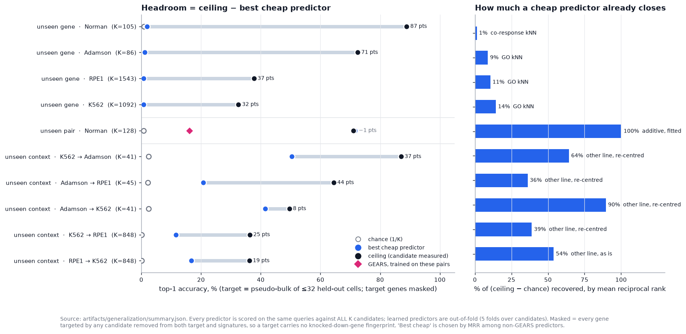
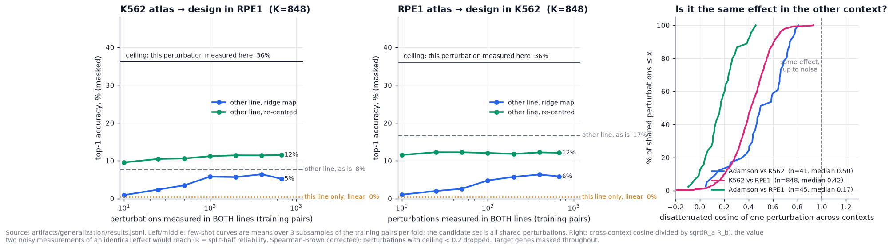
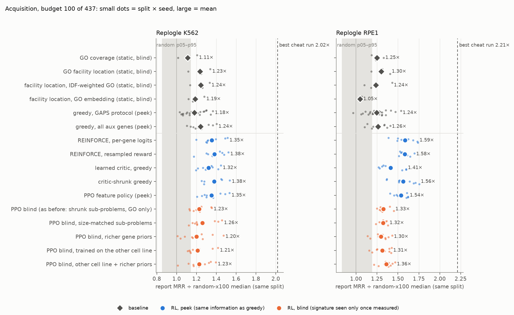
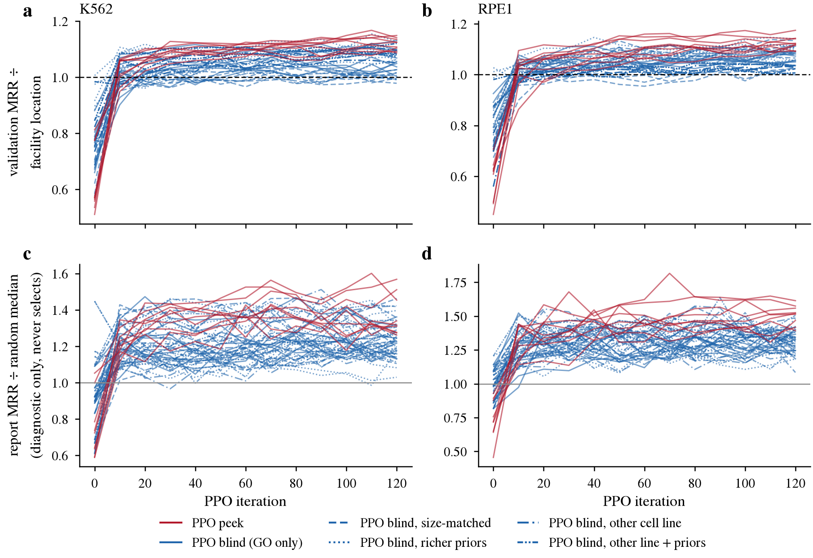
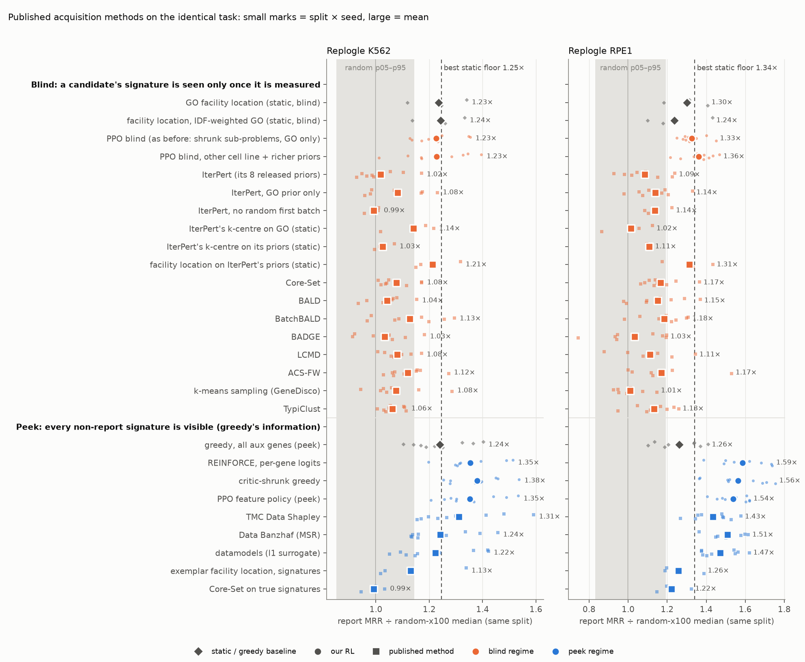
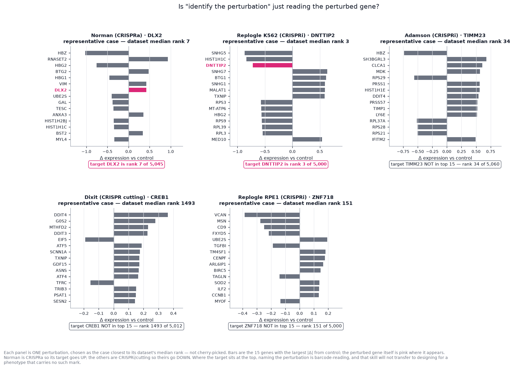
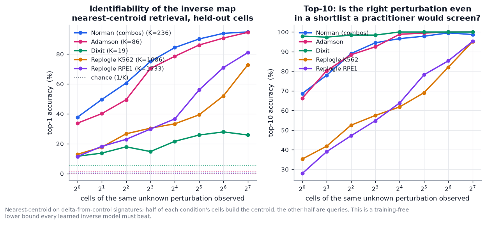
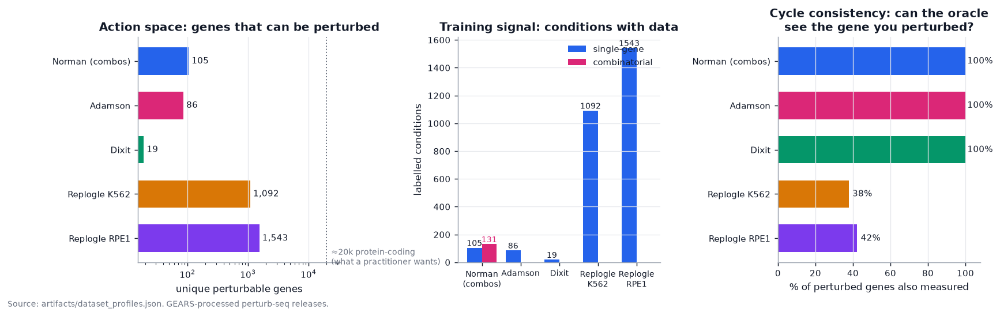
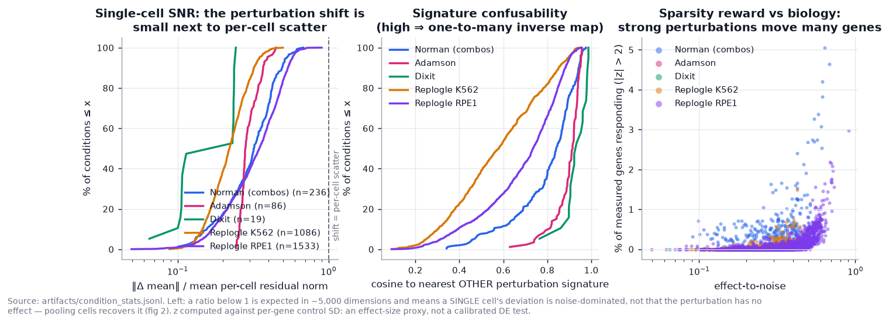

# Performance gaps in genetic inverse design

**2026-11-13.** Findings from downloading the baselines and profiling the data. Ordered by
how much performance is on the table, largest first.

Our numbers come from `/zfsauton/scratch/yixiz/10703_pj/artifacts/` and redraw with
`./submit.sh figures`. Published numbers are sourced in place. Figures referenced here
are in [figures/](figures/) and also on scratch.

---

## Summary

**Read gap 0 first — it is the one that says where to aim.** Of the three ways a candidate
perturbation can be absent from the atlas, only one is a real gap: an **unseen gene**.
Unseen *pairs* are closed completely by adding two single-gene signatures (71.6% vs a 71.1%
ceiling), and unseen *contexts* are half irreducible — the same gene genuinely acts
differently in another cell line. On the unseen-gene axis every cheap predictor, the
published linear baseline included, sits at **0.8–1.9% top-1 against a 32.5–88.9%
ceiling**. The gaps below are all measured on perturbations the atlas has already seen,
where the task is a lookup; gap 0 is the one with somewhere to go.

**RL closes part of the acquisition gap inside gap 0 (added 2026-11-16).** Choosing which
100 of 437 genes to measure is a budgeted decision problem, and greedy on a noisy reward
captures ~1.24× random. With the same information, REINFORCE, a critic-shrunk greedy and a
PPO feature policy reach **1.35–1.38× on K562 and 1.54–1.59× on RPE1**, beating greedy in
85 of 90 paired runs and roughly doubling the share of the cheating bound's margin
captured (22–23% → 34–48%). When a candidate's signature is hidden until it is measured,
which is genuine experimental design, the RL policy only matches a static GO
facility-location heuristic. See "RL on the acquisition gap" below.

**That blind regime is now closed as a negative, and the negative is the sharper result
(added 2026-11-17).** The three levers named for it — deployment-scale training
sub-problems, richer gene priors than GO Jaccard, and training on another cell line's whole
atlas — were all run, 72 runs, and **all four variants are statistically indistinguishable
from the static heuristic** (|t| ≤ 1.4 paired, win rates 3/9–6/9). The scale hypothesis is
refuted rather than merely unconfirmed: matching the scale *lowered* the policy's advantage
on its own validation problems (1.085× → 1.028×), so that advantage was never there to be
lost in transfer. The usable statement is a separation — *seeing candidate signatures is
worth 1.35–1.59×; prior knowledge alone is worth 1.23–1.30×, and a classical
facility-location heuristic already extracts all of it.* See "The blind regime" below.

**Published methods, re-run on the identical task, leave both conclusions standing (added
2026-11-18).** IterPert (RECOMB 2024: sequential design of Perturb-seq screens, evaluated
on this same K562 screen) and the eight active-learning methods it was benchmarked
against, run through IterPert's own code, all land significantly **below** the static GO
facility floor: 0.99–1.18× random against 1.23–1.30×, with IterPert itself at 1.02× / 1.09×.
A clean 2×2 shows why. IterPert's selection rule (k-centre) costs 0.09–0.28× against
facility location. Its eight multimodal priors (protein language model, text, network,
imaging screens, the other line's Perturb-seq) are worth nothing over GO Jaccard under
either rule. In the peek regime, data valuation (Data Shapley, Banzhaf, datamodels) with
REINFORCE's budget of reward evaluations reaches 1.22–1.31× / 1.43–1.51×. That beats
greedy, but trails the RL methods' 1.35–1.38× / 1.54–1.59×. See "Related work on the same
task" below.

The reward oracle, not the generator, is what limits this project. On Norman, a
parameter-free nearest-centroid match recovers the correct perturbation **86.6%** of the
time from a 128-cell target, while ranking the same 230 candidates by GEARS-predicted
signatures recovers **8.3%** — a **78-point gap**, measured with the official checkpoint
on data it was trained on.

GEARS also fails to beat a predictor that ignores which perturbation was applied: median
cosine to the measured effect is **0.691** for GEARS against **0.696** for the average
effect, and GEARS wins on **44.8%** of conditions. RL post-training improves the
generator; it cannot recover headroom the reward signal cannot see.

Two further findings change how results should be framed. High retrieval accuracy on
perturb-seq is largely *barcode-reading* — CRISPRi lowers the target's own transcript and
CRISPRa raises it, so the answer is stamped into the readout — and that will not transfer
to designing for a phenotype. And across five Perturb-seq datasets, **every published
deep-learning method sits at or below chance** on this task, while a Wilcoxon rank-sum
test reaches 0.79–0.89.

---

## Gap 0 — Only one of the three ways to be "unseen" is actually a gap

**Added 2026-11-13, after the gaps below.** Everything below measures the task on
perturbations that have *already been measured*. For those, inverse design is a lookup:
the nearest measured centroid names the perturbation and nothing needs to be learned.
Headroom can only exist where the atlas has **no entry** for a candidate, and there are
exactly three ways that happens. They turn out to be worth entirely different amounts.

One task, held fixed across all three: a target state (pseudo-bulk of ≤32 **held-out**
cells, against an independent half of the controls) is matched against **all K**
candidates. Every learned predictor is out-of-fold over 5 folds of candidates, so no
candidate is ever scored by a model fitted on it. All numbers below are in the **masked**
gene space — every gene that is any candidate's target removed — because a design target
is a phenotype and carries no knocked-down-gene fingerprint (gap 2). `summary.json` also
carries the unmasked numbers.

| Axis | Setting | K | Ceiling | Best cheap predictor | Recovered |
|---|---|---:|---:|---|---:|
| **unseen gene** | **Norman** | **105** | **88.9%** | co-response kNN **1.9%** | **1%** |
| **unseen gene** | **Adamson** | **86** | **72.5%** | GO kNN **1.2%** | **9%** |
| **unseen gene** | **Replogle RPE1** | **1,543** | **37.7%** | GO kNN **0.8%** | **11%** |
| **unseen gene** | **Replogle K562** | **1,092** | **32.5%** | GO kNN **0.8%** | **14%** |
| unseen pair | Norman combos | 128 | 71.1% | additive, fitted **71.6%** | **100%** |
| unseen context | Adamson → K562 | 41 | 49.6% | re-centred **41.5%** | 90% |
| unseen context | K562 → Adamson | 41 | 87.0% | re-centred **50.4%** | 64% |
| unseen context | RPE1 → K562 | 848 | 36.2% | other line as-is **16.7%** | 54% |
| unseen context | K562 → RPE1 | 848 | 36.3% | re-centred **11.6%** | 39% |
| unseen context | Adamson → RPE1 | 45 | 64.4% | re-centred **20.7%** | 36% |

"Recovered" is the fraction of (ceiling − chance) the cheap predictor closes, by mean
reciprocal rank. Scoring is tie-aware — a predictor that gives several candidates the same
score gets the expected rank under random tie-breaking — so a constant predictor scores
exactly chance rather than being flattered by argmax order.

**Unseen pair is not a gap. Adding two single-gene signatures *is* the answer.** A
two-parameter fit on the training combos reaches **71.6%** against a **71.1%** ceiling —
it recovers 100% of the headroom, and 77% of combos sit within 0.9 of the noise ceiling of
pure additivity. The official GEARS checkpoint, which was **trained on these very
combinations**, gets **16.1%**: four times worse than arithmetic on data it has seen.
Norman's combinations are the headline dataset for this whole literature, and the
non-additive residual there is too small to build a method on.

**Unseen context is a weak gap, and partly not learnable.**

Between the two large Replogle lines, re-centring the other line's signature recovers 39%
of the headroom with **ten** paired measurements, and the curve is flat from there to 678
— more paired data does not help. A learned ridge map from one line to the other is
*worse* than that re-centring at every training size. The reason is in the right panel: the
cross-context cosine for one perturbation, divided by the value two noisy measurements of
an *identical* effect would reach (Spearman-Brown corrected split-half reliability), has
median **0.42** between K562 and RPE1 and **0.17** between Adamson and RPE1. Only 1% of
shared perturbations reach 0.8. The same gene genuinely does something different in
another cell line, so a large part of this gap is not a modelling failure and cannot be
closed by any method. Note also the ceiling is itself low here (36%) — K562 and RPE1
signatures are intrinsically harder to tell apart than Norman's.

**Unseen gene is the gap.** It is the only axis where the ceiling is high, the cheap
predictors are at the floor, and the shortfall is not explained by noise. GO-similarity
kNN, co-response kNN, the published linear baseline and the mean effect all sit at
**0.8–1.9% top-1 against a 32.5–88.9% ceiling**, recovering **1–14%**. On Norman the
ceiling is 88.9% and everything cheap gets 1.9%. The predictors are not failing at
fidelity — GO kNN reaches 0.46 cosine to the held-out effect against a 0.67 noise ceiling
on K562, i.e. ~70% of what is achievable — they are failing at *discrimination*: they
predict roughly the right general direction for every gene and cannot say which gene.

This also explains the Nature Methods result the field keeps rediscovering. The linear
baseline of [Ahlmann-Eltze, Huber & Anders (2025)](https://doi.org/10.1038/s41592-025-02772-6)
is in the table above, out-of-fold: **0.3–1.0% top-1**. Its paper's finding that deep
models fail to beat it is usually read as "the deep models are no good". The sharper
statement is that **both sit near the floor of a task whose ceiling is 30–90 points
higher**, and that this is the one place in the problem where that is true.

> **Why the ceiling is a fair ceiling.** It is computed from a *disjoint half* of each
> condition's cells against an *independent half* of the controls, so it is not fitting the
> query. The cheap predictors, by construction, never see the held-out gene at all — that
> is the point. The gap is between "this gene has been measured here" and "it has not".

**What this means for the project.** Pick the unseen-gene axis, on one of the two Replogle
datasets (K=1,092/1,543 is a real action space; Norman's 105 is not). Drop the combination
story — it is arithmetic — and treat cross-cell-line transfer as a measurement problem, not
a method one. The open question on this axis is sharp and unclaimed: *given a gene never
perturbed in this context, predict its effect specifically enough to tell it from 1,000
other genes.* Prior knowledge about the gene (GO, pathways, sequence, its own co-response
profile) is the only available input, and the measured value of all of it so far is ~1%.

Reproduce with `./submit.sh gen` (CPU, ~5 min) →
`artifacts/generalization/{results.jsonl,summary.json}`; redraw with `./submit.sh genfigs`.

---

## Is the unseen-gene gap RL-shaped?

**Added 2026-11-16.** Gap 0 says where the headroom is. This asks whether any of it is a
*decision* problem, since this is an RL project. Two candidate framings, both measured by
`jobs/26_rl_headroom.sbatch` (CPU, artifacts in `artifacts/rl_headroom/`).

### Framing A — a ranking objective. Dead.

The diagnosis in gap 0 was that predictors have fidelity (~70% of the noise ceiling in
cosine) but no discrimination. One explanation is that the gene-specific signal is present
and simply not scored, because squared error spends capacity on the component every
perturbation shares. If so, a ranking reward — non-differentiable, hence RL — would recover
it. We test the cheapest version: take the *same* predictions and only change the scoring
geometry. Centre them, then whiten in a subspace fitted on training genes. No information
enters.

| top-1 (masked) | ceiling | raw | centred | best whitened |
|---|---:|---:|---:|---:|
| Replogle K562 | 33.7% | 0.32% | 0.69% | 0.37% |
| Replogle RPE1 | 37.4% | 0.42% | 0.71% | 1.43% |

Whitening makes MRR *worse* everywhere (K562 0.066 → 0.011). RPE1's 1.43% looks like a 3×
gain until its MRR drops 0.053 → 0.040: it sharpens a few cases and scrambles the rest.

**The discrimination is not in the prediction waiting to be scored differently.** That kills
the rank-reward framing — and kills contrastive learning for the same reason, which is the
more useful half of the result, since contrastive is what a reviewer would demand instead
of RL. The limit is the input representation (GO terms), not the loss.

### Framing B — which genes to measure. Alive, and the shape of it is the interesting part.

The atlas is a choice. Someone picked the 1,092 genes in the K562 screen. So: state = genes
measured so far, action = which gene to measure next, transition = reveal its **real**
signature, reward = retrieval MRR on held-out genes, horizon = a budget. Discrete actions,
non-differentiable reward, and it simulates offline against real measurements — episodes are
matrix operations, no oracle model in the loop.

Budget spent in 4 rounds, reported on held-out genes the strategy never sees. `adapt_greedy`
picks greedily on its own legitimate reward (a disjoint *selection* gene set);
`oracle_greedy` runs the same greedy directly on the report set and **cheats**, bounding
what any adaptive policy could reach.

| Replogle K562, rep MRR | B=25 | B=50 | B=100 | B=200 |
|---|---:|---:|---:|---:|
| random | 0.091 | 0.111 | 0.163 | 0.225 |
| GO coverage (static) | 0.115 | 0.136 | 0.191 | 0.222 |
| adapt_greedy (honest) | 0.111 | 0.151 | 0.188 | 0.250 |
| **oracle_greedy (cheats)** | **0.174** | **0.227** | **0.307** | **0.405** |
| oracle / random | 1.91× | 2.05× | 1.88× | 1.80× |
| adapt_greedy / random | 1.22× | 1.36× | 1.15× | 1.11× |

RPE1 is harder: `adapt_greedy` reaches only 0.98–1.18× random and **loses to static GO
coverage at three of four budgets**, while `oracle_greedy` still reaches 2.0–2.7×.

Three facts, and the third is the project:

1. **The prize is real and large.** At K562 B=200, `oracle_greedy` reaches **top-1 0.327**
   against the **0.337** ceiling — choosing 200 of 656 genes well predicts the other genes
   almost as well as having measured them. The atlas is massively redundant.
2. **Cheap static heuristics get a little of it.** Greedy GO-term set-cover is ~1.2–1.3×
   random and beats *searching 200 random subsets*, so it is the baseline to beat, not
   random.
3. **Greedy on the true reward captures only ~1.2× of a ~2× prize, because the reward does
   not generalise across gene sets.** `adapt_greedy` optimises hard on 218–308 selection
   genes and most of its advantage evaporates on a disjoint 218–308. Part 2 shows the same
   thing non-adaptively: best-of-200 random subsets lands *below* the random median on two
   of five RPE1 budgets.

**That third fact is the RL problem.** It is not "apply RL to biology" — it is a
high-variance, overfitting-prone reward in a combinatorial acquisition MDP, which is what
variance reduction, learned baselines and policy generalisation exist for. The gap between
1.2× (greedy on a noisy reward) and ~2× (what exists) is the quantity a method would move,
with static GO coverage as the honest floor.

### Is the prize unfindable, or hidden behind a noisy reward?

That is the question that decides the project, and the two readings differ testably. If the
cheat's margin is pure overfitting, nothing a policy does will reach it. If instead the
reward is unbiased but **high-variance**, then growing the gene set the reward is computed
on must raise performance on a *fixed, disjoint* report set. Three-way disjoint splits:
`act` (437 genes a policy may measure), `rew` (the reward's genes, subsampled), `rep` (the
report set, which only the cheating bound ever sees). Budget 100, four rounds.

| Replogle K562 | own reward | **rep MRR** | vs random median |
|---|---:|---:|---:|
| random × 100 (median) | — | 0.178 | — |
| greedy, 25 reward genes | 0.721 | 0.168 | **−6%** |
| greedy, 50 | 0.512 | 0.171 | −4% |
| greedy, 100 | 0.409 | 0.168 | −6% |
| greedy, 200 | 0.310 | 0.214 | +20% (> p95) |
| greedy, 400 | 0.224 | **0.221** | **+24% (> p95, > max)** |
| cheat (selects on rep) | 0.293 | 0.293 | +65% |

RPE1 behaves the same way: −6% to −16% below the random median up to 200 reward genes, then
**+23%** at 400, clearing p95; the cheat sits at 2.13×.

Read the `own reward` column next to it. At 25 reward genes greedy drives its own objective
to **0.721** and delivers **0.168** held out — it is not underfitting, it is fitting noise,
and the result is **worse than choosing genes at random**. Optimising a high-variance reward
is actively harmful here; the harm disappears monotonically as the estimate improves.

**This is reading (b), and it is the project.** Three things follow:

1. **Reward quality, not search quality, is the binding constraint.** The same greedy search
   goes from −6% to +24% purely by estimating its reward better.
2. **The curve has not plateaued at 400 reward genes**, and greedy there captures only
   **37%** (K562) and **20%** (RPE1) of the cheat's demonstrated margin. Most of the prize
   is still unclaimed, and the lever is variance in the reward.
3. That is exactly what **learned baselines, reward averaging and policy generalisation**
   are for — core RL machinery, aimed at a failure mode measured here rather than assumed.

> **A methodological correction worth keeping.** Parts 3 and 4 originally compared against a
> *single* random draw. Part 2 had already shown random spans ±15% around its median, and
> the single draw used in part 4 (0.218) turned out to sit near the **maximum** of 100 draws
> (max 0.221, median 0.178) — so greedy looked flat when it was in fact beating p95. Any
> claim here is now against the median of 100 draws, with p95 and max reported. A single
> random baseline cannot measure an effect the same size as its own spread.

Reproduce with `./submit.sh rl` (`PJ_RL_PARTS="1 2"` selects parts; `PJ_RL_RANDOM_ONLY=1`
re-measures only the random distribution).

> **Two of the numbers above are single draws (corrected 2026-11-16, next section).** The
> "+24%, > p95, > max" for greedy at 400 reward genes and the cheat's 0.293 are each one
> run, and greedy's path depends on arbitrary tie-breaking in the kNN. Over 3 splits × 8
> seeds, part 4's exact protocol averages **1.18× random on K562 and 1.24× on RPE1**. The
> qualitative reading (the reward is noisy; greedy captures a minority of the prize)
> survives. The specific margins do not.

---

## RL on the acquisition gap

**Added 2026-11-16.** Framing B ended on a claim to test: greedy acquisition chases its
reward's noise and captures ~1.2× random of a ~2× prize, which is the failure that learned
baselines, variance reduction and policy generalisation exist for. Three RL approaches,
each testing a different explanation of why greedy falls short, on exactly part 4's task:
choose 100 of 437 genes, build the GO-kNN predictor from the chosen genes, and score
retrieval MRR on report genes no method sees. The run uses part 4's split (seed 4
reproduces its random median to 1e-6) plus two more splits, with 3 seeds per method.

| method | what is learned | explanation it tests |
|---|---|---|
| REINFORCE, per-gene logits | one Plackett–Luce logit per candidate, leave-one-out baseline; the `resampled` variant draws half the reward genes anew each episode | **search**: same information and objective as greedy, only the optimiser changes |
| learned critic | fitted one-step value (γ = 0) of a gene's *held-out* gain, from features; used greedily, and as a control variate that shrinks greedy's empirical gain toward it | **reward estimate** |
| PPO feature policy | 2×32 MLP scoring each candidate from 13 (peek) or 10 (blind) features plus 4 context, group-relative (GRPO-style) advantages, trained on thousands of re-split sub-problems, checkpoint chosen on validation sub-problems | **generalisation**: a rule cannot memorise one reward set |

Two information regimes. **Peek**: every non-report signature is visible, including a
candidate's before it is chosen. Part 4's greedy used exactly this (it scores a candidate
by inserting its real signature), so peek is the fair comparison for greedy. **Blind**: a
signature is revealed only once measured, in 4 batched rounds, and the policy is trained
only on the already-measured atlas. This is genuine sequential experimental design. Every
learned method trains on sub-problems re-split three ways (candidates / visible / hidden
reward), so it is always rewarded on genes its features could not see.

| report MRR ÷ random-×100 median | K562 | share of cheat margin | RPE1 | share | beats greedy, paired |
|---|---:|---:|---:|---:|---|
| GO facility location (static, no signatures) | 1.23× | 23% | 1.30× | 25% | — |
| greedy, part 4's protocol (24 runs) | 1.18× | 17% | 1.24× | 20% | — |
| greedy, every aux gene, every candidate | 1.24× | 23% | 1.26× | 22% | — |
| **REINFORCE, per-gene logits** | **1.35×** | **34%** | **1.59×** | **48%** | 9/9 · 9/9 |
| REINFORCE, resampled reward | 1.38× | 37% | 1.58× | 48% | 8/9 · 9/9 |
| learned critic, used greedily | 1.32× | 32% | 1.41× | 34% | 6/9 · 9/9 |
| **critic-shrunk greedy** | **1.38×** | **37%** | **1.56×** | **46%** | 9/9 · 9/9 |
| PPO feature policy, peek | 1.35× | 34% | 1.54× | 44% | 8/9 · 9/9 |
| PPO feature policy, blind | 1.23× | 22% | 1.33× | 27% | ties facility, 5/9 · 5/9 |
| best cheating run (selects on the report genes) | 2.02× | 100% | 2.21× | 100% | |

Means over 3 splits × 3 seeds, each run divided by its own split's random median. Every
peek RL run clears its split's random p95. In absolute terms, K562 goes from 0.217 (greedy,
all aux genes) to **0.237–0.242**, and RPE1 from 0.129 to **0.157–0.162** (+25%). "Share of
cheat margin" is (run − random median) / (best cheat − random median) on the same split.
Every chosen set is re-scored by `rl_headroom`'s own functions in the analysis env
(below).

**1. With greedy's own information, every RL approach beats greedy, and the share of the
prize captured roughly doubles.** The peek methods win 85 of 90 paired comparisons with
greedy on the same split, and all 45 on RPE1. The cheap baselines cluster tightly at
1.18–1.30×. The RL methods sit at 1.32–1.59×.

**2. All three explanations hold, to different degrees.**

- **Search.** REINFORCE gets the exact reward greedy maximises, and reaches a *higher value
  of that same reward*: aux MRR 0.233 against greedy's 0.193 on K562, and 0.135 against
  0.100 on RPE1. Its report MRR is higher as well. With 470–850 reward genes greedy is not
  mainly overfitting. It is a poor optimiser of a set objective that is not submodular
  (adding a gene can push a better neighbour out of a target's top 10). Policy gradient on
  ES~π[R(S)] optimises the set jointly. Resampling the reward genes leaves the
  mean unchanged. It halves the within-split seed spread on RPE1 (sd 0.0040 vs 0.0085) but
  widens it on K562 (0.0122 vs 0.0079), so it is not a reliable variance reducer here.
- **Reward estimate.** Greedy's one-step gain, measured on the visible genes, correlates
  only **r = 0.17** (0.14–0.23) with the same gene's gain on held-out genes. A critic that
  never sees those genes, predicting from features alone, reaches **0.26**, and the two
  combined reach 0.28. This is the reward noise of Framing B, now as a number: a gene's
  value is predicted better from what kind of gene it is than by measuring it on a few
  hundred visible genes. Shrinking greedy's gain toward the critic beats greedy in 18 of 18
  paired runs.
- **Generalisation.** PPO never optimises the deployment reward at all, yet it lands
  within noise of REINFORCE (1.35× / 1.54×). Its own-reward is low (aux MRR 0.156 vs 0.233),
  so it got there by learning a rule rather than fitting the reward set. The rule is
  legible. On gradient attribution, all 18 peek policies agree: prefer genes whose GO
  neighbours share their signature (`coherence`, +2.7); avoid genes whose signature or GO
  profile duplicates one already chosen (−1.5, −1.0). REINFORCE's logits belong to the
  specific candidates it optimised. PPO's rule applies to genes it never saw.

**3. The blind regime is not closed.** When a candidate's signature stays hidden until it
is measured, PPO matches GO facility location (1.23× vs 1.23×; 1.33× vs 1.30×; 5/9 wins
each) and does no better. The policy did learn something: at its selected checkpoint it
beats facility location by 5–13% on validation sub-problems drawn like its training ones
(fig16, top). That gain does
not survive the move from training sub-problems (190–340 candidates, budget 43–78, drawn
from the measured atlas alone) to deployment (437 candidates, budget 100). What it learned
is facility location plus "prefer genes whose measured GO neighbours agree" and "avoid
genes whose predicted signature duplicates a measured one".

**4. The cheat is a looser bound than it looked.** The cheating subsets reach 2.02× and
2.21× on the genes they were fitted to, and the *lowest* aux MRR of any strategy (0.12 on
K562, below GO coverage at 0.13 and facility location at 0.15). A subset chosen on 182
report genes is mostly fitted to those genes. So "share of cheat margin" understates how
much of the *transferable* prize the RL methods reach, and the real ceiling for a policy
that cannot see the report genes is somewhere below 2×.

### Two corrections found while building the baselines

**A single greedy run is itself one draw.** GO-kNN picks its 10 neighbours with
`argpartition`, and GO-Jaccard ties are everywhere. numpy 2.x (the analysis env, where
GAPS ran) breaks those ties differently from numpy 1.26 (the torch env). The RNG streams
are identical and the fast scorer agrees with `rl_headroom` to 1e-5, yet part 4's exact
greedy protocol (400 reward genes, 120 sampled candidates, the same seed) gives **0.221**
in one env and **0.190** in the other. That is the difference between "+24%, clears p95"
and "+7%, does not". Over 8 seeds on that split the protocol spans 0.187–0.239, so part
4's 0.221 was one reasonable draw from a wide distribution. A random subset's score moves by only ~0.0003, but greedy's path
diverges. The correction already made for random draws applies to greedy too, so greedy
and the cheat now run over 8 seeds (3 for the all-candidate variant) and are read as
distributions. On RPE1 split 204 the same protocol spans 0.096–0.147 across seeds, from
below the random median (0.100) to above the random max (0.133). Every number in this section is
re-scored in the analysis env; re-scoring moves a chosen set's MRR by 0.003 on average
(max 0.012).

**The honest floor is GO facility location, not GO coverage.** Choose genes so that every
gene has a close GO neighbour among them: greedy facility location on GO Jaccard. It uses
no signature at all, so it is legal in the blind regime. It reaches 1.23× on K562 and
1.30× on RPE1, level with greedy on every aux gene (1.24×, 1.26×), which reads 470–850
real signatures to do the same. Static GO coverage, the floor Framing B used, is 1.11× and
1.25×. An acquisition method has to beat facility location, not random.

### What this means for the project

- **On the peek task, RL is a real, measured improvement.** It is atlas compression: which
  of the measured genes best predict the rest. The cleanest RL story is the learned critic
  used as a control variate for a noisy reward. It has a diagnostic (r 0.17 → 0.26) that
  explains *why* it works, and it beats greedy 18/18. PPO is the version that transfers to
  new genes. REINFORCE is the strong per-instance optimiser. Facility location and
  multi-seed greedy must appear as baselines in any table.
- **The prospective (blind) version is where the open problem now sits.** RL there only
  matches a static GO heuristic. The measured obstacle is train/deploy mismatch in
  sub-problem scale, not a policy that learns nothing. The next experiments are size-matched
  training sub-problems, training the blind policy on another cell line's full atlas
  (K562 → RPE1), and gene priors richer than GO.
  > **Superseded 2026-11-17.** All three were run and none works; the train/deploy-mismatch
  > diagnosis in this bullet is wrong — the validation advantage it rests on does not
  > survive size matching, which means it was noise. See "The blind regime" above.
- Caveats: 3 splits × 3 seeds; one predictor (GO-kNN), so which genes are informative may
  change with a better predictor; the peek methods read candidate signatures and are not
  prospective design.

Reproduce with `./submit.sh rlacq`, all CPU: cache 2 min, baselines ≤ 45 min, 15 training
tasks ≤ 45 min, report 2 min. Outputs go to
`artifacts/rl_acquire/{report.md,summary.json,records.jsonl}`. Redraw with
`./submit.sh rlacq_report`.

> **The three "next experiments" listed above have now been run. None of them works —
> next section.**

---

## The blind regime: three levers, none of them closes it

**Added 2026-11-17.** The section above ended with the blind regime open and named three
suspects for it: training sub-problems smaller than deployment, a GO-only view of a gene,
and a training atlas too small to fix the first. One variant each, plus the combination,
on the identical splits, predictor and report genes — 4 variants × 2 datasets × 3 splits ×
3 seeds = 72 runs, 0 errors. **All four land on the static floor.**

| report MRR ÷ random median | K562 | vs best floor (wins) | RPE1 | vs best floor (wins) |
|---|---:|---:|---:|---:|
| GO facility location (static, GO Jaccard) | 1.23× | — | **1.30×** | — |
| facility location, IDF-weighted GO (static) | **1.24×** | — | 1.24× | — |
| facility location, GO embedding (static) | 1.19× | — | 1.05× | — |
| PPO blind, as before (shrunk sub-problems, GO only) | 1.23× | −0.0035 (4/9) | 1.33× | −0.0016 (4/9) |
| PPO blind, **size-matched** sub-problems | 1.26× | +0.0027 (6/9) | 1.32× | −0.0020 (3/9) |
| PPO blind, **richer gene priors** | 1.20× | −0.0079 (4/9) | 1.30× | −0.0046 (3/9) |
| PPO blind, **trained on the other cell line** | 1.21× | −0.0060 (3/9) | 1.31× | −0.0028 (3/9) |
| PPO blind, other cell line **+ richer priors** | 1.23× | −0.0034 (4/9) | 1.36× | +0.0022 (5/9) |

"Best floor" is the strongest static heuristic on the same split across all three prior
views — the floor a policy that is *given* those views has to clear. Every one of the ten
paired comparisons is **statistically indistinguishable from it**: |t| ≤ 1.4 over 9 paired
runs, win rates 3/9–6/9. The largest blind number anywhere, RPE1 cross-line + rich at
1.36×, is t = +0.54 with 5/9 wins. That is a coin flip, not a result.

**The scale hypothesis is not merely unconfirmed, it is refuted.** Size matching worked as
intended — training sub-problems went from 183 candidates / budget 42 to **437 / 100**,
deployment's own numbers, and the cross-line variant trains at 437/100 with 307 reward and
799 visible genes, deployment scale on all three sets. The diagnostic that decides it is
the policy's advantage over facility location **on its own validation sub-problems**,
i.e. before any transfer:

| val MRR ÷ facility location, at training scale | K562 | RPE1 |
|---|---:|---:|
| shrunk sub-problems (as before) | 1.085× | 1.088× |
| size-matched | **1.028×** | 1.081× |
| richer priors | 1.100× | 1.107× |
| other cell line | 1.086× | 1.036× |
| other cell line + richer priors | 1.104× | 1.042× |

Matching the scale **lowered** it on K562 and left it flat on RPE1. In every configuration
it sits at 1.03–1.11×. The advantage was never large enough to survive anything — it is not
being destroyed in transfer, **it was never there**. The earlier reading, that a 5–13%
validation gain died at deployment scale, was reading noise in a small validation set.

**Richer priors do not help statically either, which is the cleaner statement.** Facility
location under the IDF-weighted view reaches 1.24× / 1.24× and under the 32-dimension term
co-occurrence embedding 1.19× / 1.05×, against plain Jaccard's 1.23× / 1.30×. Two different
richer similarity views, neither better than Jaccard on both lines. The predictor is
unchanged throughout (GO-kNN on Jaccard), so every number stays comparable; only the
*policy's* view was enriched. GO similarity was not the binding representation here in the
way gap 0 suggests it is for the *prediction* problem.

### What this means

- **The peek result is unaffected and remains the project's RL finding.** 1.35–1.59×
  random, 85 of 90 paired wins over greedy, with the critic diagnostic (r 0.17 → 0.26)
  explaining why. That is atlas compression, and it stands.
- **The blind regime should be reported as a measured near-ceiling, not an open
  engineering problem.** Prior annotation alone appears to carry about **1.2–1.3× random**
  of acquisition signal, and a classical greedy facility-location heuristic — no learning,
  no data, seconds to run — already extracts essentially all of it. Five different learned
  policies, three information settings and two cell lines do not beat it.
- **The honest way to state the project's result** is therefore a separation: *knowing the
  candidates' signatures is worth ~1.35–1.59×; prior knowledge alone is worth ~1.23–1.30×,
  and a 1970s heuristic already gets that.* The gap between them is the value of the
  measurement, not of the method.
- The open problem that survives is **not** policy architecture. It is the input: a
  prospective policy needs a gene representation that predicts *effect*, and GO, IDF-GO and
  GO co-occurrence all fail to. Sequence, expression and pathway-topology priors are
  untested here, and gap 0 says the same thing from the prediction side.

### Caveats

- 3 splits × 3 seeds per variant (9 runs), one predictor (GO-kNN), one budget (100 of 437).
  A negative result at this n rules out effects of the size the peek methods showed
  (+0.02–0.03 MRR, 100% win rates), not arbitrarily small ones.
- `ppo_blind_match` needs `act ∪ aux` as its training pool to reach deployment scale, so
  deployment-candidate signatures enter its training **reward** (never its features). It is
  the leakier variant and it still does not beat the floor, which only strengthens the
  negative. `ppo_blind_xline` has no such leak: nothing of the deployment line enters
  training or checkpoint selection.
- The `ppo_blind` row's "train scale" prints as `static` in `report.md` because those runs
  predate the field; its real scale is 183/42 (K562) and 247/57 (RPE1).
- The two new static floors were added by re-running the baselines with `PJ_RLA_FORCE=1`;
  all 25 pre-existing rows reproduced exactly, score and chosen set, so no earlier number
  moved. The generalised facility-location path reproduces `go_facility` under the Jaccard
  view on all 6 splits.

Reproduce with `PJ_RLA_FORCE=1 ./submit.sh rlacq_base` (the static floors) and
`PJ_RLA_METHODS="ppo_blind_match ppo_blind_rich ppo_blind_xline ppo_blind_xline_rich"
./submit.sh rlacq_runs` (~2.5 h, all CPU).

---

## Related work on the same task

**Added 2026-11-18.** Every comparison above is against baselines we wrote. This section
runs the published methods for this problem on the **identical task**: the same splits,
the same budget (100 of 437, spent in 4 rounds of 25), the same GO-kNN predictor and the
same report genes. Every chosen set is re-scored by `rl_report.py` beside every RL run.
Only the selection rule changes. 270 runs, 0 errors.

**What was run** (`scripts/related_work.py`):

| regime | method | how |
|---|---|---|
| blind | **IterPert** (Huang, Lopez, Hütter, Kudo, Rios, Regev; RECOMB 2024) | the closest prior work: sequential design of Perturb-seq screens, benchmarked on this same Replogle K562 screen. Run through **IterPert's own code**, configured line for line from `iterpert.py`: MaxDist (k-centre) on the mean of max-normalised kernels, i.e. its 8 released prior kernels plus the model's kernel |
| blind | Core-Set, BALD, BatchBALD, BADGE, LCMD, ACS-FW | IterPert's published benchmark, through the same code (its fork of `bmdal_reg`) with IterPert's exact selection/transform settings |
| blind | k-means sampling (GeneDisco), TypiClust | ported from IterPert's `query_strategies` |
| peek | TMC Data Shapley, Data Banzhaf (MSR), datamodels | data valuation, the standard answer to "which training points make a predictor good". Each runs on greedy's and REINFORCE's own reward (MRR on aux) with **REINFORCE's budget of 19,200 reward evaluations**, and keeps the top 100 |
| peek | exemplar facility location, Core-Set, both on the true signatures | "pick representative signatures" |

Two adaptations were unavoidable. **The model.** IterPert's kernels come from GEARS's
per-perturbation output. Here the model is the deployed predictor's own rule: a gene is
represented by its GO-kNN predicted signature from every measured gene (aux plus the genes
chosen so far, leave-one-out), refitted after each round. A blind method receives a
signature matrix whose unmeasured rows are NaN, so it cannot read a hidden signature by
accident. **The protocol.** IterPert's benchmark starts from a random labelled batch, then
runs acquisition rounds. Scaled to this budget, that is 25 random and then 3 × 25 by the
method. It is also the only protocol the reference code supports: BALD, BatchBALD and
BADGE need labelled genes for their posterior transform. `IterPert, no random first batch`
measures what that batch costs.

### Blind: every published method sits below the static floor

| report MRR ÷ random median | K562 | vs GO facility floor (wins, t) | RPE1 | vs floor (wins, t) |
|---|---:|---:|---:|---:|
| GO facility location (static, ours) | **1.23×** | — | **1.30×** | — |
| PPO blind (ours) | 1.23× | −0.004 (4/9, −0.8) | 1.33× | −0.002 (4/9, −0.4) |
| **IterPert, its 8 released priors** | **1.02×** | −0.040 (0/9, −8.6) | **1.09×** | −0.026 (0/9, −9.3) |
| IterPert, GO prior only | 1.08× | −0.030 (3/9, −2.9) | 1.14× | −0.021 (0/9, −4.3) |
| IterPert, no random first batch | 0.99× | −0.045 (0/3, −3.7) | 1.14× | −0.021 (0/3, −3.4) |
| BatchBALD | 1.13× | −0.022 (2/9, −2.1) | 1.18× | −0.016 (1/9, −3.4) |
| ACS-FW | 1.12× | −0.023 (1/9, −3.4) | 1.17× | −0.018 (1/9, −2.4) |
| Core-Set | 1.08× | −0.030 (2/9, −3.7) | 1.17× | −0.018 (1/9, −3.1) |
| LCMD | 1.08× | −0.030 (0/9, −4.2) | 1.11× | −0.024 (1/9, −3.2) |
| k-means sampling (GeneDisco) | 1.08× | −0.031 (2/9, −3.1) | 1.01× | −0.034 (0/9, −7.1) |
| TypiClust | 1.06× | −0.033 (0/9, −7.0) | 1.13× | −0.021 (2/9, −3.4) |
| BALD | 1.04× | −0.036 (0/9, −7.0) | 1.15× | −0.019 (1/9, −4.1) |
| BADGE | 1.03× | −0.038 (0/9, −5.7) | 1.03× | −0.031 (1/9, −4.2) |

Differences are MRR, paired by split against the best static floor on that split (the
strongest of the three prior views), with a one-sample t over runs. In all 22 cells
(11 methods × 2 lines) the published method is below the floor, at t from −2.1 to −9.3.
PPO blind beats every one of them, by 0.014–0.042 MRR. **IterPert itself is statistically
indistinguishable from choosing at random on K562** (1.02×, 1% of the cheat's margin). It
ties the benchmark it was published against (1.01–1.18×), and the random first batch is
not the cause (0.99× / 1.14× without it).

**The rule, not the priors, is what loses.** Four static, prior-only variants: no model
kernel, no random batch, nothing learned.

| report MRR ÷ random median, K562 / RPE1 | GO Jaccard | IterPert's 8 priors |
|---|---:|---:|
| k-centre (IterPert's MaxDist rule) | 1.14× / 1.02× | 1.03× / 1.11× |
| facility location (our floor's rule) | **1.23× / 1.30×** | **1.21× / 1.31×** |

Switching the rule from k-centre to facility location gains **+0.09 to +0.28×** in every
column. Switching the prior from GO to IterPert's eight moves the score by −0.11 to +0.09×
under k-centre, with no consistent sign, and by −0.02 / +0.01 under facility location. One
reading of why: k-centre minimises the distance of the *worst-covered* gene, so it buys
outliers, while facility location maximises *total* coverage, which is what a kNN
reference atlas needs. BALD (max posterior variance) and BADGE (distance-weighted sampling)
share k-centre's pull toward the far tail. That reading is not separately measured here.

**This closes the representation question the blind regime left open.** "The blind regime"
ended on gene priors richer than GO (sequence, expression, pathway topology) as the untested
input. IterPert's priors are exactly those: PoPS gene features, ESM protein-language-model
embeddings, BioGPT text embeddings, node2vec on the GEARS GO graph, three optical pooled
screens, and the other cell line's Perturb-seq. Under the best static rule they tie GO
Jaccard on both lines (1.21× vs 1.23×, 1.31× vs 1.30×). That extends the 2026-11-17
negative from GO-derived views to multimodal ones. The priors enter only the selection; the
predictor stays GO-kNN, as everywhere in this section. A predictor that consumes the priors
is gap 0's question, not this one.

### Peek: data valuation beats greedy, but not the RL methods

| report MRR ÷ random median | K562 | vs REINFORCE (wins, t) | RPE1 | vs REINFORCE (wins, t) |
|---|---:|---:|---:|---:|
| greedy, all aux genes | 1.24× | −0.020 (0/9, −10.4) | 1.26× | −0.033 (0/9, −7.5) |
| **REINFORCE, per-gene logits (ours)** | **1.35×** | — | **1.59×** | — |
| **critic-shrunk greedy (ours)** | **1.38×** | +0.004 (5/9, +1.4) | **1.56×** | −0.003 (5/9, −0.9) |
| PPO feature policy, peek (ours) | 1.35× | −0.000 (5/9, −0.1) | 1.54× | −0.005 (2/9, −1.9) |
| TMC Data Shapley | 1.31× | −0.008 (3/9, −1.4) | 1.43× | −0.016 (1/9, −3.3) |
| Data Banzhaf (MSR) | 1.24× | −0.020 (0/9, −4.9) | 1.51× | −0.008 (5/9, −2.0) |
| datamodels (l1 surrogate) | 1.22× | −0.023 (0/9, −4.7) | 1.47× | −0.012 (2/9, −2.5) |
| exemplar facility location, signatures | 1.13× | −0.039 (0/3, −4.3) | 1.26× | −0.034 (0/3, −13.5) |
| Core-Set on true signatures | 0.99× | −0.064 (0/3, −4.9) | 1.22× | −0.037 (0/3, −4.2) |

- **Data valuation is the strongest published family, and it still trails RL.** All three
  methods beat greedy on RPE1 (89–100% wins); on K562 only Shapley does (7/9). The best
  valuation method on each line comes within 0.008 MRR of REINFORCE, which is not
  significant at n = 9 (t = −1.4 and −2.0). But it is a different method on each line:
  Shapley on K562, where Banzhaf is level with greedy, and Banzhaf on RPE1, where Shapley
  trails REINFORCE at t = −3.3. The three RL methods are the only ones in the
  1.35–1.38× / 1.54–1.59× band on both lines.
- **The reward is mostly additive, and the rest is what RL buys.** A linear model of the
  size-100 reward on inclusion indicators explains **60%** of its variance (datamodels,
  5-fold CV R²). Ranking genes by those coefficients still loses to REINFORCE by
  0.023 / 0.012 MRR. The unexplained part is interaction (one gene's value depends on which
  neighbours are already in), which is what optimising the set jointly captures. This is
  the "search" explanation from "RL on the acquisition gap", now with a number on it.
- **Seeing the signatures is not enough by itself.** Choosing representative signatures
  (facility location or k-centre on the true signatures) lands at or below greedy:
  0.99–1.13× on K562, 1.22–1.26× on RPE1. The value comes from optimising the predictor's
  own retrieval reward, not from coverage of signature space.

### What this means

- **The project now has its related-work table, and both RL conclusions survive it.**
  Peek: RL ≥ every published data-selection method at REINFORCE's evaluation budget,
  clearly so against all but the best one per line. Blind: no learned method, ours or
  published, beats the static floor. The published active-learning methods sit
  significantly *below* it, and PPO blind beats every one of them.
- **Frame the published methods' numbers fairly.** IterPert and GeneDisco were built for a
  different objective: the error of a trained model (GEARS) on unseen perturbations. Here
  the objective is retrieval with a GO-kNN reference set. "Below the floor here" says that
  diversity-seeking acquisition is the wrong bias for this objective. It does not say the
  methods are broken: the same code reproduces its own selection exactly (checks below).
- The blind separation now reads: *prior knowledge, GO or eight richer modalities, is worth
  ~1.2–1.3× random, and facility location already extracts it; IterPert's rule recovers
  almost none of it.*

### Caveats

- The model view (GO-kNN predicted signatures) stands in for GEARS's embeddings. A
  different representation might help the model-based methods. The static 2×2 does not
  depend on it.
- IterPert released priors only for K562. On RPE1 the same recipe is applied: the authors'
  own mean imputation for genes a source lacks, which covers 84% of RPE1 candidates.
  `rpe1_kernel` is dropped there (it is the deployment screen's own signatures, i.e. the
  answer). A K562 Perturb-seq prior built the same way is added, covering 55% of
  candidates. On K562 all eight priors cover 99.5% of candidates.
- Omitted: BAIT (`iterpert.py` marks it "there is bug somehow"); ProbCover (its radius is set
  by k-means purity against a number of *classes* this task does not have, and its soft
  relative, facility location, is the floor); GeneDisco's ensemble-uncertainty methods
  (BALD and BatchBALD are the GP-posterior versions in the same benchmark);
  BioDiscoveryAgent (an LLM agent with a different objective, hit discovery).
- n = 9 per stochastic method and n = 3 per deterministic one, per line. One predictor, one
  budget. The valuation budget is matched to REINFORCE's 19,200 evaluations, not to PPO's or
  the critic's.
- Library drift: sklearn 1.9 rather than the authors' (its KMeans `n_init` default changed);
  IterPert's `dill` import is stubbed (used only by save/load helpers that never run here).
- `report.md` also carries a separate, in-progress mechanism diagnostic ("Why the published
  blind methods lose": GO coverage vs reference coherence). It was added independently and
  is not summarised here.

**Fidelity checks.** The kernel zip matches Dataverse's MD5. Every released kernel equals
feat featᵀ to 3×10⁻⁷, so rebuilding it on our genes is the same prior. A numpy replica of
IterPert's MaxDist picks the same genes as IterPert's own code on 100% of 72 rounds
(99.9% on 54 GO-only rounds, min 96%). No bmdal method hit its random-fill fallback. The
third-party pickles load through an unpickler that admits only numpy arrays.

Reproduce with `./submit.sh related` (fetch ~1 min, prior alignment ~1 min, a 39-task CPU
array of ≤ 10 min, then the report). Outputs go to
`artifacts/rl_acquire/related/{runs/,priors_*.npz,priors_check.json}`, the "Related work on
the same task" section of `artifacts/rl_acquire/report.md`, and fig17.

---

## Gap 1 — The reward oracle is the bottleneck, not the generator

Three scorers on one identical task — given a target cell state, rank 230 candidate
perturbations — so the rungs subtract.

- **Ceiling** — rank by the Δ-signature *measured* from labelled cells. Not a usable
  designer, but it bounds what any method could extract from a target state.
- **Oracle** — rank by the Δ-signature GEARS *predicts*. Every oracle-driven method is
  capped by this rung: PDGrapher's inverse map, LabCompass's MAP/Langevin/guidance, and
  any RL policy whose reward is this oracle.
- **Non-conditional** — the average perturbation effect, ignoring which perturbation.

| Cells pooled | Ceiling | GEARS oracle | Gap | Kept | Median rank |
|---:|---:|---:|---:|---:|---|
| 1 | 25.4% | 4.2% | 21.2 pts | 16.6% | 6 → 36 |
| 8 | 59.9% | 8.6% | 51.3 pts | 14.3% | 1 → 15 |
| 32 | 73.9% | 11.4% | 62.5 pts | 15.4% | 1 → 12 |
| **128** | **86.6%** | **8.3%** | **78.3 pts** | **9.6%** | **1 → 13** |

**Read the shape, not the heights** (the y-axis is log, which flatters the oracle). The
ceiling keeps climbing as cells are pooled; the oracle flattens near 10%. More data raises
what is achievable and does nothing for GEARS, because the limit is its prediction error,
not noise in the target.

On fidelity, the oracle does not beat the predictor that ignores perturbation identity:

| Quantity | Value |
|---|---:|
| median cos(GEARS Δ, measured Δ) | 0.691 |
| median cos(average effect, measured Δ) | **0.696** |
| conditions where GEARS wins | **44.8%** |
| median cos(GEARS Δ, average effect) | 0.768 |

Its predictions sit closer to the global average than to the truth.

Named cases, each panel labelled with *why* it was chosen so you can see they aren't
cherry-picked. Ask of each: does blue track green, or orange? In the **median case
`S1PR2`** the average effect scores **0.62 against GEARS's 0.60**. In `TSC22D1` the
measured activation of the target is ≈1.0 while GEARS predicts ≈0.05, missing the CRISPRa
target's own induction.

Ranking is close to noise. For target `CNN1+UBASH3A` the top score is **0.853** and the
correct answer **0.848** — five ranks inside 0.005. `CNN1+UBASH3A` is also GEARS's top
pick for an unrelated target (`IGDCC3+ZBTB25`): it funnels different queries toward the
same few combinations, which is what predicting the average looks like in practice.

---

## Gap 2 — Retrieval success is barcode-reading, not design

Where the perturbed gene's own |Δ| ranks among all measured genes. Direction-agnostic on
purpose: Norman is CRISPRa (target goes *up*), the others CRISPRi/cutting (target goes
*down*).

| Dataset | Rank 1 | Top 10 | Top 100 | Median rank | Target unmeasured | Direction |
|---|---:|---:|---:|---:|---:|---|
| norman | 18.0% | 54.8% | 84.8% | **8** / 5,045 | 0% | up (CRISPRa) |
| replogle_k562_essential | 39.2% | 61.6% | 80.0% | **3** / 5,000 | 62% | down |
| adamson | 15.1% | 37.2% | 64.0% | 34 / 5,060 | 0% | down |
| replogle_rpe1_essential | 12.3% | 23.4% | 43.5% | 151 / 5,000 | 58% | down |
| **dixit** | 0.0% | 0.0% | **5.3%** | **1,493** / 5,012 | 0% | mixed |

**Retrievability tracks fingerprint strength, and Dixit proves it by exception.** Dixit
leaves no fingerprint — it is CRISPR *cutting*, so the transcript often survives — and it
is the one dataset where retrieval fails (25.8% top-1 over just 19 candidates, median rank
never below 3).

> **The direction correction mattered.** Ranking only by most-downregulated inverted the
> conclusion for Norman, whose CRISPRa targets go *up*: it read rank 5,029 of 5,045 from
> the bottom, which is rank 8 from the top. The first version of this analysis had Norman
> as the *least* barcode-like dataset when it is the most.

One named perturbation per dataset, each the case closest to that dataset's *median* rank.
`DLX2` (Norman) is pink near the top going up; `DNTTIP2` (Replogle K562) is the single
largest down bar; `CREB1` (Dixit) has no pink bar at all — rank 1,493, buried.

**Why it matters:** a design task specifies its target by a desired *phenotype*, which
carries no knocked-down-gene fingerprint. The published identification numbers, good or
bad, do not transfer. The relevant baseline for this project is Gap 1's oracle rung, not
the ceiling.

---

## Gap 3 — The target must be a population, not a single cell

The proposal says "user-specified target cell state" without saying how many cells define
it. That unstated choice is worth more than every published model-vs-model gain combined.

| Dataset | K | 1 cell | Best pooled |
|---|---:|---:|---:|
| norman (canonical) | 236 | 37.7% | **94.8%** |
| adamson | 86 | 33.7% | **94.5%** |
| replogle_rpe1_essential | 1,533 | 11.4% | 81.0% |
| replogle_k562_essential | 1,086 | 12.9% | 72.8% |
| dixit | 19 | 11.6% | 25.8% |

Parameter-free nearest-centroid, no training. Median rank on Replogle RPE1: **90 at one
cell, 1 at 32**.

The cause is single-cell SNR (`fig3`, left panel): the ratio of mean shift to mean
per-cell residual norm has median 0.22–0.35 and sits below 1.0 for every condition in all
five datasets. Below 1 is *expected* in ~5,000 dimensions and means a single cell's
deviation is noise-dominated — not that the perturbation has no effect. Pooling recovers it.

**Two consequences.** Fix the target to a pseudo-bulk of ≥32 cells and say so. And this
baseline costs nothing to run, so it belongs in every results table: an RL method landing
under 94.8% on Norman has no result.

---

## Gap 4 — No published learned method beats a statistical test

The cross-method check, run because one paper's weak numbers could be that paper's
artifact. They are not. From [CDN (Wu et al., ICML 2025)](https://arxiv.org/abs/2410.03380)
Table 1, five Perturb-seq datasets, normalized rank where **0.5 is chance**:

| Method | Range | Kind |
|---|---:|---|
| Linear | 0.45 – 0.51 | deep-learning baseline |
| MLP | 0.45 – 0.53 | deep-learning baseline |
| GenePt | **0.31** – 0.52 | deep-learning baseline |
| GEARS | 0.45 – 0.56 | our proposed oracle |
| PDGrapher | 0.48 – 0.54 | published inverse SOTA |
| *chance* | *0.50* | — |
| **Wilcoxon + BH** | **0.79 – 0.89** | a statistical test |
| CDN | 0.92 – 0.98 | shortlisted, non-trivial subset |

GenePt (0.31) and PDGrapher (0.39 unseen cell line) fall *below* chance. The authors state
it directly: *"no other deep learning method exceeds simple statistical tests."*

CDN's own 0.92–0.98 needs its conditions attached: it ranks inside a ≤1,000-gene shortlist
that already contains the answer, reports **no top-1 accuracy anywhere on real data**, and
excludes the majority of perturbations as "trivial" (the target simply *is* the most-changed
gene). On that trivial subset CDN scores 0.99 and every deep-learning baseline is still
0.40–0.60.

PDGrapher's own extended-data figure agrees on bulk LINCS. Its genetic panels plot **nine
methods together** and the axis ceilings bound all of them: accurately predicted samples
**0–1.5%**, nDCG **0–0.12**, recall@1/@10/@100 within **0–0.14**, over ~10,716 candidate
genes. The caption concedes scGen — not PDGrapher — leads on nDCG, and that PDGrapher
recovers targets "at comparable rates". The one absolute pair given is **1.37% vs 0.28%**
on Ovary-ES2.

STATE corroborates on the forward side: on genetic data it *"matched the performance of
the perturbation mean baseline"*, and a linear model beat it on DE overlap by 20%.

---

## Gap 5 — The design space is too small for the proposed machinery

| Source | Perturbable genes |
|---|---:|
| PDGrapher evaluation (BioGRID PPI nodes) | **10,716** |
| replogle_rpe1_essential | 1,543 |
| replogle_k562_essential | 1,092 |
| **norman** | **105** (→ 152 single + 131 combo) |
| adamson | 86 |
| dixit | 19 |

Against ~20,000 protein-coding genes. Norman's 131 combinations cover **2.4%** of the
5,460 possible pairs from its 105 genes. The 7×–500× mismatch between what a model is
*scored* over and what it has *labels* for is a large part of why recall@1 is under 1%.

At this scale the problem is a contextual bandit, where a softmax policy gradient — or
simply scoring every arm through the oracle — beats post-training a flow model. **Either
commit to k-gene subsets over the full genome, where enumeration is impossible and a
generator is justified, or accept this is a bandit and use the simple method.** The middle
ground is the one place the proposed machinery has no advantage.

---

## Gap 6 — Cycle consistency cannot separate right from nearly-right

Median cosine between a perturbation's Δ-signature and that of its **nearest other**
perturbation (middle panel, read where each line crosses 50%):

| adamson | dixit | norman | replogle_rpe1 | replogle_k562 |
|---:|---:|---:|---:|---:|
| 0.91 | 0.93 | 0.85 | 0.74 | 0.58 |

For a typical perturbation some *different* perturbation produces a near-identical
signature, so reproducing the target does not prove you found the cause. `fig12` shows the
same thing from the other side: top five candidates separated by 0.005.

**PDGrapher ablates this exact mechanism and reports against it.** `PDGrapher-Super`
"achieves the highest performance in predicting correct perturbagens", while the shipped
`PDGrapher-SuperCycle` has "slightly lower performance in pinpointing targets". Adding the
cycle term *traded away* target accuracy. (Their ablation was chemical-only.)

If the term is kept: whiten or decorrelate the signature space first, or score only on each
condition's own DE-gene subset, and report cycle consistency as a **rank** against all
candidates rather than an absolute distance.

The right panel carries a separate warning: stronger perturbations move more genes, so a
sparsity reward fights biology rather than selecting for cleanliness.

---

## Gap 7 — Most of the large action spaces are invisible to the oracle

Right panel of [`fig1_action_space.png`](figures/fig1_action_space.png). Fraction of
perturbed genes that are themselves measured:

| norman | adamson | dixit | replogle_k562 | replogle_rpe1 |
|---:|---:|---:|---:|---:|
| 100% | 100% | 100% | **38%** | **42%** |

The first three read 100% only because GEARS filtered them to measured genes — and they
are the small ones. On the only two datasets with an action space above ~100 genes, the
oracle cannot report the expression of the gene you perturbed for most actions. An
on-target-knockdown or cycle-consistency reward is not merely weak there, it is
**unmeasurable**.

Note the collision with Gap 2: Replogle K562 has the strongest fingerprint of any dataset
(median rank 3 of 5,000) and simultaneously the weakest coverage (38%). The signal that
makes retrieval easy is unavailable across most of its action space.

---

## Novelty re-scoping

LabCompass's code was released **2026-10-28**, after the proposal was written. Reading it
narrows the claim. In `code/LabCompass/src/labcompass/`:

- `inverse/loss_guidance.py` → `LossGuidedFlow` steers a pretrained flow toward
  `loss_fn(x1) + c·Σ reg_fn(x1)`. That is penalties from biological restraints, already
  weighted and composable.
- `inverse/kkt.py` + `inverse/implicit_dual_opt.py` → `KKTConditions`,
  `ImpliciDualGuidedFlow` implement **inequality constraints `g_i(x1) ≤ 0`** with Lagrange
  multipliers by least squares. Hard constraints arguably fit biological restraints better
  than reward weights — "stay under k perturbed genes", "avoid this pathway" are
  constraints, not preferences, and KKT needs no weight tuning.
- `models/inverse.py` → `InverseModel(inverse_method=...)` takes `"map"`, `"langevin"` and
  **`"neural"`**. The last predicts perturbation covariates directly, so "replacing search
  with learning" already ships.

Guidance and KKT both differentiate the objective w.r.t. the generated variable. What is
genuinely left, and worth claiming precisely:

1. **Non-differentiable, black-box rewards** — a selectivity score that is a rank statistic
   over oracle output, sparsity as an L0 count, pathway avoidance as set membership, or any
   call to a non-differentiable simulator. RL needs only a scalar. *The proposal does not
   currently claim this, and it is the strongest claim available.*
2. **Discrete action spaces** — gene sets are discrete; continuous guidance needs a
   relaxation, a discrete policy does not.
3. **Reward composition at training time** rather than per-target re-tuning of weights.

That reframing fixes the headline experiment: **our RL policy vs LabCompass guidance on a
differentiable reward** (the control, should be comparable) **and on a reward that is not**
(where only RL can run).

Two related points. PDGrapher is not a drop-in baseline for this framing — its genetic task
is disease→treated across 10 cell lines with one target phenotype per line, so it cannot be
asked for an arbitrary target state. And three 2026 works occupy adjacent ground, all
uncited because they postdate the proposal: **PertMind** (arXiv 2608.16419, RL on
perturbation data via an LLM), a **NeurIPS 2026** paper on compositional perturbation
planning with a generative structural causal world model, and **U-Pert** (bioRxiv
2026.06.30.735555, inverse design for target gene programs, no public code found).

---

## Recommendations

In priority order; the first gates the rest.

1. **Measure the oracle held-out before designing any reward.** Run
   `jobs/22_retrain_oracle.sbatch` (retrains GEARS under `split='simulation'`, re-probes on
   held-out conditions). Every number here is from a checkpoint trained on all of Norman,
   so the regime RL will actually explore is unmeasured. If the held-out margin over the
   non-conditional baseline is thin, switch the oracle to STATE (already cloned) first.
2. **Fix the target to a pseudo-bulk of ≥32 cells** and state it. Report the
   nearest-centroid baseline in every results table as the floor.
3. **Read ceiling − oracle before committing to the RL plan.** If it remains most of the
   headroom, this project should be about the oracle, not the generator — a publishable
   finding in its own right, not a failure.
4. **Pick a side on the action space**: k-gene subsets over the full genome, or accept this
   is a bandit.
5. **Re-scope the novelty** to non-differentiable reward and discrete actions; make the
   LabCompass comparison the headline experiment.
6. **Treat cycle consistency as a design constraint, not a given.**
7. **Drop Dixit.** Norman for combinations, Replogle RPE1 for action-space scale, Adamson
   as the easy-case sanity check.

One framing note: honest absolute numbers on this task will be small, and the field's
published numbers are small too. The write-up needs a well-chosen metric and relative gains
against a stated floor, or correct work will read as failure.

---

## Caveats

- Every GEARS number is from `gears_misc_umi_no_test`, trained with `split='no_test'` on
  **all** Norman perturbations. Train-set numbers, an optimistic bound.
- PDGrapher's genetic axis ceilings were read from tick labels of its extended-data vector
  PDF. Tick labels are text, bar heights are paths — so those bound the plotted bars rather
  than being them.
- **STATE has no inverse task in its preprint**, only two forward tasks. An earlier draft
  of this review claimed otherwise from an unverified search summary; withdrawn. The Cell
  version is paywalled.
- CDN's Table 1 was transcribed, not reproduced by us. Its normalized-rank metric is not
  comparable to our top-1 accuracies.
- `fig6_oracle_quality` (DE-gene Pearson probe) has not completed; it needs one clean solo
  GPU run.

### Evaluation traps found the hard way

- **Raw Pearson is inflated.** Correlating predicted against measured *expression* rather
  than deltas reads ~0.99 for any predictor, including one that predicts no change — with
  ~5,000 genes sharing one baseline profile you are mostly measuring that both vectors
  describe a human cell. This is frequently the number reported.
- **Duplicate condition encodings.** Norman lists the same single-gene perturbation as both
  `X+ctrl` and `ctrl+X`; **47 of 283** conditions are twins. Scoring them separately
  inflates K and marks a correct answer wrong when the model picks the twin. Correcting it
  moved Norman's ceiling 71.7% → 86.6% and widened the headline gap 62 → 78 points. All
  numbers here are post-correction.
- **Ensembl vs gene name.** `uns['top_non_dropout_de_20']` stores Ensembl IDs while
  `adata.var` carries both `gene_id` and `gene_name`. Matching the wrong one empties every
  DE set and the probe still reports `status: ok` with zero rows.

See [README.md](README.md) for the download inventory, job list and cluster gotchas.
